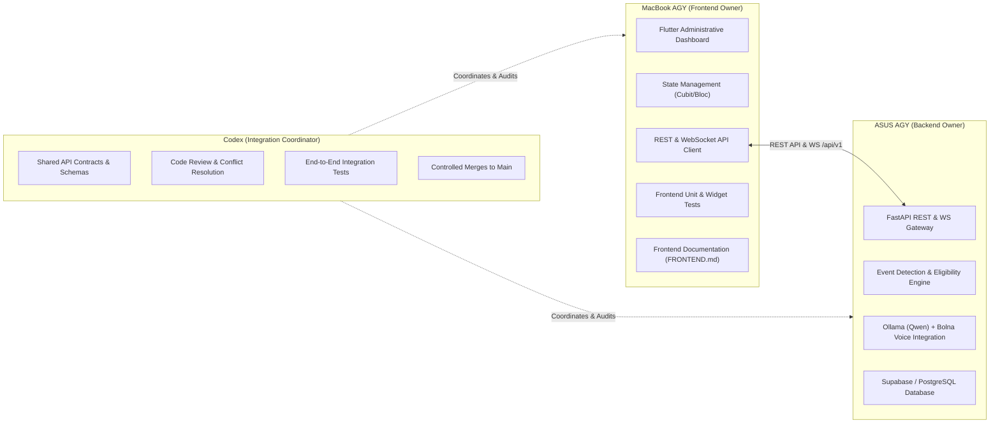

# Bharat Assist — Frontend Implementation Guide & Architecture (FRONTEND.md)

> **Administrative Cockpit & Citizen Simulation Frontend Specification**

[](#1-executive-summary--architectural-scope)
[](#2-target-technology-stack)
[](TECH.md)
[](README.md)

---

## 1. Executive Summary & Architectural Scope

Bharat Assist requires a responsive, high-fidelity administrative dashboard and simulation interface for operators, evaluators, and system architects. The frontend serves as the primary visual interface to:

1. **Manage Synthetic Citizens**: Display, search, and inspect 100 fictional citizen records with demographic attributes.
2. **Simulate Life Events**: Adjust citizen dates of birth or advance simulation clocks to trigger age milestones (e.g., reaching 18 years of age).
3. **Inspect Scheme Eligibility**: Visualize real-time rule engine evaluations across statutory Indian public services (Voter ID Form 6, Learner's Licence, etc.).
4. **Monitor Simulated Calls**: Track the idempotent dispatch queue, call attempts, and granular audio/transcript telemetry.
5. **Review Spoken Transcripts**: Inspect bidirectional conversations conducted in natural Hinglish between the citizen and the AI assistant (powered by Ollama/Qwen and Bolna on the backend).
6. **Provide Observability**: Display backend connectivity status, latency metrics, and Voice Activity Detection (VAD) barge-in events.

The frontend is implemented purely in **Flutter 3.19+ and Dart 3.3+**, with initial support for **macOS Desktop** and **Web (Chrome)**.

---

## 2. Target Technology Stack

| Layer | Component | Architectural Purpose |
| :--- | :--- | :--- |
| **Framework** | **Flutter 3.19+ & Dart 3.3+** | Cross-platform UI toolkit targeting macOS Desktop and Web. |
| **State Management** | **Bloc / Cubit (`flutter_bloc`)** | Predictable, decoupled state management with explicit states (`Initial`, `Loading`, `Loaded`, `Error`). |
| **Networking & HTTP** | **`http` / `dio`** | REST API client with configurable base URLs, timeouts, retry logic, and JSON deserialization. |
| **Realtime Telemetry** | **`web_socket_channel` / SSE** | Real-time streaming for live call status updates and transcript events. |
| **Design System** | **Material 3 (M3)** | Clean administrative UI with accessible Indian national tricolor accents (saffron, ashoka blue, forest green). |
| **Testing Harness** | **`flutter_test` & `bloc_test`** | Unit, Cubit state, and Widget tests for regression testing. |

---

## 3. Team Ownership & Integration Boundaries



### Responsibility Breakdown
- **MacBook AGY**:
  - Flutter UI layouts, themes, responsive navigation rails, and widgets.
  - Client-side state management with explicit loading/error handling.
  - REST API client and WebSocket streaming consumers.
  - Automated frontend test suites.
  - Administrative dashboard documentation.
- **ASUS AGY**:
  - Python / FastAPI backend implementation.
  - Relational database schema, migrations, and seeds.
  - Rule-based eligibility engine and age milestone detector.
  - Local LLM inference via Ollama (Qwen) and Bolna voice agent integration.
  - Backend integration tests.
- **Codex**:
  - Overall system architecture and API contract maintenance.
  - Code review across both development branches.
  - End-to-end integration testing and controlled merging into `main`.

---

## 4. Proposed Frontend Directory Structure

```text
frontend/
├── pubspec.yaml                        # Dependencies and asset registrations
├── analysis_options.yaml               # Strict Dart linter rules
├── README.md                           # Setup, build, and run instructions
├── assets/
│   ├── icons/                          # SVG/PNG status and scheme icons
│   └── images/
├── test/
│   ├── unit/
│   │   ├── models/
│   │   │   ├── citizen_test.dart       # JSON deserialization & validation tests
│   │   │   ├── call_job_test.dart      # Idempotency and status parser tests
│   │   │   └── eligibility_test.dart   # Qualification schema tests
│   │   └── services/
│   │       ├── api_client_test.dart    # Error handling, timeouts, retry assertions
│   │       └── citizens_api_test.dart
│   ├── widget/
│   │   ├── citizens_screen_test.dart   # Table rendering, pagination, filter tests
│   │   ├── dob_dialog_test.dart        # DOB life-event simulation input tests
│   │   └── call_monitor_test.dart      # Transcript rendering & live stream updates
│   └── mocks/
│       ├── mock_api_client.dart        # Test doubles for offline verification
│       └── mock_data.dart              # Synthetic fixture data matching backend schemas
└── lib/
    ├── main.dart                       # Application entrypoint & dependency injection
    ├── app.dart                        # MaterialApp configuration, routes & global themes
    ├── core/
    │   ├── config/
    │   │   ├── env_config.dart         # Backend host IP, port, WS URL, timeouts
    │   │   └── api_routes.dart         # Centralized endpoint paths (/citizens, /demo/calls)
    │   ├── theme/
    │   │   ├── app_theme.dart          # Professional Material 3 administrative theme
    │   │   ├── app_colors.dart         # Accessible tricolor accents & status colors
    │   │   └── app_typography.dart     # Clean typographic scale
    │   ├── errors/
    │   │   ├── failures.dart           # UI-friendly domain failure types
    │   │   └── exceptions.dart         # NetworkException, ServerException, ParseException
    │   └── utils/
    │       ├── date_formatter.dart     # IST formatting & age calculator
    │       └── text_helpers.dart
    ├── models/
    │   ├── citizen.dart                # Fictional citizen profile with is_fictional guard
    │   ├── service_scheme.dart         # Scheme model (Voter ID, Learner's Licence, etc.)
    │   ├── eligibility_result.dart     # Qualification outcome & requirements checklist
    │   ├── call_job.dart               # Outbound call queue record & idempotency key
    │   └── call_event.dart             # Spoken transcript turn, latency_ms & speaker tag
    ├── services/
    │   ├── api/
    │   │   ├── api_client.dart         # Robust HTTP client (base URL, timeouts, logging)
    │   │   ├── citizens_api_service.dart     # GET /citizens, PATCH /citizens/{id}
    │   │   ├── eligibility_api_service.dart  # POST /citizens/{id}/evaluate
    │   │   └── call_jobs_api_service.dart    # POST /demo/calls, GET /demo/calls/{id}
    │   └── websocket/
    │       └── call_stream_service.dart      # Live telemetry & transcript stream consumer
    ├── state/
    │   ├── connection/
    │   │   ├── connection_cubit.dart   # ASUS backend health check polling / status
    │   │   └── connection_state.dart
    │   ├── citizens/
    │   │   ├── citizens_cubit.dart     # Citizen list, pagination, and DOB manipulation
    │   │   └── citizens_state.dart     # CitizensInitial, Loading, Loaded, Error
    │   ├── eligibility/
    │   │   ├── eligibility_cubit.dart  # Recalculation triggers & scheme details
    │   │   └── eligibility_state.dart
    │   └── call_monitor/
    │       ├── call_monitor_cubit.dart # Call jobs queue and transcript inspection
    │       └── call_monitor_state.dart
    └── screens/
        ├── shell/
        │   ├── main_layout.dart        # Responsive navigation rail / sidebar layout
        │   └── top_bar.dart            # Backend connection status indicator & quick settings
        ├── dashboard/
        │   ├── dashboard_screen.dart   # Overview KPIs (Total citizens, milestones, active calls)
        │   └── widgets/
        │       ├── metric_card.dart
        │       └── recent_activity_feed.dart
        ├── citizens/
        │   ├── citizens_list_screen.dart # 100 fictional citizens data table
        │   └── widgets/
        │       ├── citizen_detail_sheet.dart
        │       ├── dob_simulation_dialog.dart  # Milestone trigger modal (update DOB)
        │       └── citizen_filter_bar.dart
        ├── eligibility/
        │   ├── eligibility_screen.dart   # Schemes view & qualification rules
        │   └── widgets/
        │       ├── scheme_card.dart
        │       └── evaluate_button.dart
        └── call_monitor/
            ├── call_monitor_screen.dart  # Live call queue & transcript player
            └── widgets/
                ├── transcript_viewer.dart     # Dialogue turns (AI vs Citizen in Hinglish)
                ├── telemetry_metrics_tile.dart# Latency (ms), barge-in count, topic switches
                └── call_status_badge.dart     # QUEUED, IN_PROGRESS, COMPLETED, FAILED
```

---

## 5. Screen Specifications & User Workflows

### 5.1 Shell & System Status (`main_layout.dart`, `top_bar.dart`)
- **Navigation Rail**: Persistent side navigation supporting seamless switching across Dashboard, Citizens, Eligibility, and Call Monitor views.
- **Backend Health Pill**: Visible indicator displaying the real-time status of the ASUS FastAPI connection (`Connected [192.168.x.x:8000]`, `Polling...`, or `Offline [Retry]`).
- **Endpoint Modal**: Easily configure or switch the backend host URL/port without requiring a rebuild.

### 5.2 Synthetic Citizen Management (`citizens_list_screen.dart`)
- Renders paginated data tables for 100 fictional citizen records.
- Highlights mandatory synthetic safeguards (`is_fictional = true` badge on every record).
- **Life-Event Simulation Trigger**:
  - Operators select a citizen and click *"Simulate 18th Birthday"*.
  - Opens `dob_simulation_dialog.dart` prefilled with a date calculating the citizen's age to exactly 18.
  - Dispatches `PATCH /api/v1/citizens/{id}`.
  - On success, dynamically highlights the detected milestone: `MILESTONE_AGE_18`.

### 5.3 Eligibility Results (`eligibility_screen.dart`)
- Displays all evaluated public welfare and civic documentation schemes:
  - **ECI Voter ID (Form 6)**: Free statutory application, age $\ge$ 18.
  - **MoRTH Learner's Licence**: Parivahan online test, age $\ge$ 18.
- Button: *"Trigger Re-evaluation"*, calling `POST /api/v1/citizens/{id}/evaluate`.
- Displays qualifying reasons, missing supporting documents, and direct links to official portals (`voters.eci.gov.in`, `parivahan.gov.in`).

### 5.4 Call Queue & Live Transcript Viewer (`call_monitor_screen.dart`)
- **Call Job Pipeline**: Monitors status progression: `QUEUED` $\rightarrow$ `IN_PROGRESS` $\rightarrow$ `COMPLETED` / `RETRY_SCHEDULED` / `FAILED`.
- **Transcript Inspector**:
  - Color-coded chat bubbles distinguishing the AI Agent (Hinglish dialogue) from the Citizen.
  - Live streaming transcript updates received over WebSocket.
- **Audio Telemetry Dashboard**:
  - Round-trip voice latency (ms).
  - Voice Activity Detection (VAD) barge-in / interruption counters.
  - Spontaneous topic-switch tracking (e.g., Voter ID $\leftrightarrow$ Driving Licence).

---

## 6. Expected API Contracts (For Coordination with ASUS Backend)

| Method | Endpoint | Description | Request Body | Response Highlights |
| :---: | :--- | :--- | :--- | :--- |
| `GET` | `/api/v1/health` | Backend connection health check. | *None* | `{"status": "ok", "version": "1.0.0"}` |
| `GET` | `/api/v1/citizens` | Paginated synthetic citizens list. | Query: `limit`, `offset`, `age` | `{"total": 100, "citizens": [...]}` |
| `PATCH` | `/api/v1/citizens/{id}` | Update citizen date of birth. | `{"date_of_birth": "YYYY-MM-DD"}` | `{"citizen_id": "...", "calculated_age": 18, "event_detected": "MILESTONE_AGE_18"}` |
| `POST` | `/api/v1/citizens/{id}/evaluate` | Recalculate scheme eligibility. | `{}` or `{"force": true}` | `{"citizen_id": "...", "eligible_services": [...], "call_job_scheduled": true}` |
| `POST` | `/api/v1/demo/calls` | Schedule simulated outbound call. | `{"citizen_id": "...", "trigger_event": "MILESTONE_AGE_18"}` | `{"job_id": "...", "idempotency_key": "...", "status": "QUEUED"}` |
| `GET` | `/api/v1/demo/calls/{id}` | Retrieve call status & transcript. | *None* | `{"job_id": "...", "status": "COMPLETED", "events": [...]}` |
| `WS` | `/api/v1/voice/session/{id}` | Real-time transcript & telemetry stream. | WebSocket handshake | Streaming JSON event frames |

---

## 7. Frontend Testing Strategy

- **Unit Tests (`test/unit/`)**:
  - Validate model JSON serialization and deserialization.
  - Validate date parsing and age computation utilities.
  - Assert that `ApiClient` handles HTTP 4xx, 5xx, and network timeout exceptions gracefully.
- **State Management Tests (`test/unit/services/`)**:
  - Assert Cubit state sequence transitions: `Initial` $\rightarrow$ `Loading` $\rightarrow$ `Loaded`.
  - Assert error handling when the backend returns 500 or is unreachable.
- **Widget Tests (`test/widget/`)**:
  - Assert citizen table renders correctly with mock data.
  - Assert modal input validation prevents future dates of birth.
  - Assert call status badges reflect correct color-coded states.

---

## 8. Implementation Readiness

Scaffolding of the Flutter application will begin once Codex and ASUS AGY confirm the agreed API endpoint signatures and JSON serialization conventions.
