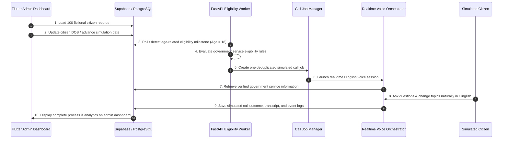
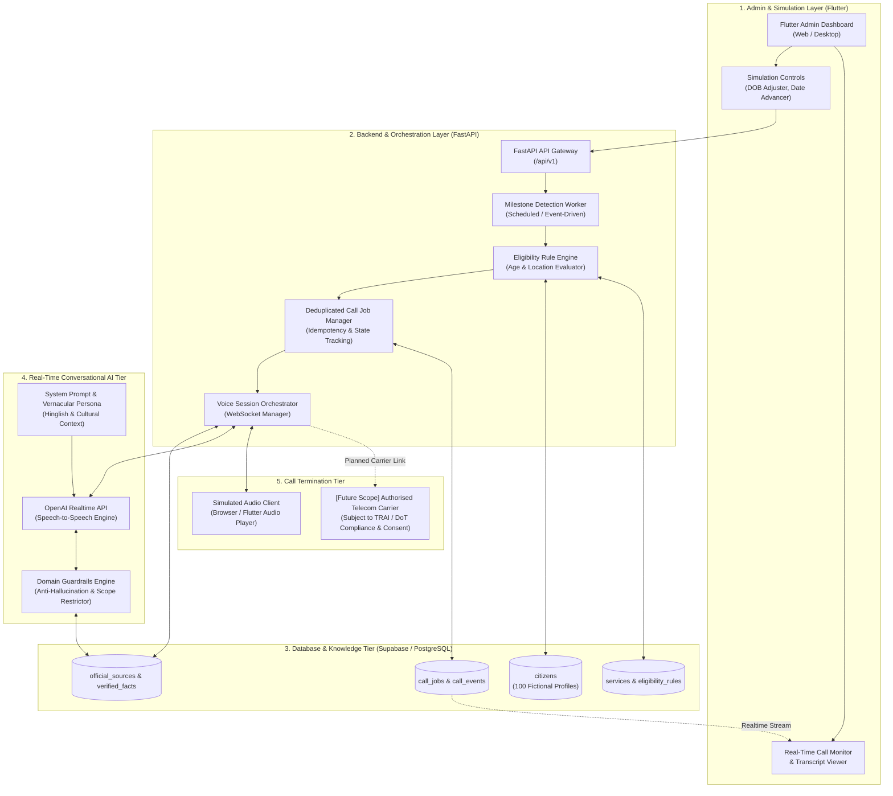

# Timbre

> **AI-Powered, Voice-First Proactive Government Services Assistant for India**

[](#overview)
[](#license)
[](#technology-stack)
[-3ECF8E.svg)](#technology-stack)
[](#technology-stack)
[](#technology-stack)

---

## Table of Contents

1. [Project Overview](#project-overview)
2. [Problem Statement](#problem-statement)
3. [Proposed Solution](#proposed-solution)
4. [Key Features](#key-features)
5. [End-to-End Prototype Workflow](#end-to-end-prototype-workflow)
6. [Technology Stack](#technology-stack)
7. [System Architecture](#system-architecture)
8. [Proposed Repository Structure](#proposed-repository-structure)
9. [Database Design](#database-design)
10. [API Design](#api-design)
11. [Real-Time Voice Conversation Design](#real-time-voice-conversation-design)
12. [Government Data Sources](#government-data-sources)
13. [Setup and Installation (Planned)](#setup-and-installation-planned)
14. [Environment Variables and Secret Management](#environment-variables-and-secret-management)
15. [Privacy, Security, Responsible AI, and Prototype Limitations](#privacy-security-responsible-ai-and-prototype-limitations)
16. [Development Roadmap](#development-roadmap)
17. [Testing Strategy](#testing-strategy)
18. [Future Scope](#future-scope)
19. [License](#license)

---

## Project Overview

**Timbre** (originally conceptualized as *Bharat Assist*) is a prototype conversational AI platform designed to bridge the digital divide between Indian citizens and essential public services. Built with a voice-first architecture, Timbre proactively notifies eligible citizens about welfare schemes, statutory documents, and citizen entitlements as they reach key life milestones—such as turning 18 years of age.

Rather than requiring citizens to navigate complex multi-tier web portals or decipher bureaucratic notices, Timbre initiates natural, real-time spoken conversations in conversational **Hinglish** (Hindi mixed with Indian English). The conversational agent answers questions, explains step-by-step application procedures, details required documents, and allows fluid topic shifts—all grounded in verified government data.

> [!IMPORTANT]
> **Prototype & Simulation Notice**  
> Timbre is an independent proof-of-concept prototype built for research, hackathon evaluation, and architectural demonstration. It is **not** an operational government utility, is **not** officially affiliated with or endorsed by the Government of India or any state administration, and does **not** connect to production government citizen databases. All initial demonstrations operate exclusively on **100 fictional citizen records**, and all outbound voice sessions are **simulated** within a controlled test environment.

---

## Problem Statement

India has established world-class digital public infrastructure (DPI)—including Aadhaar, DigiLocker, UPI, Parivahan Sewa, and the National Voter's Service Portal. However, significant structural hurdles remain for tens of millions of citizens:

1. **Information Asymmetry & Proactivity Deficit**: Citizens routinely miss critical eligibility milestones (e.g., voter registration at 18, youth employment programs, educational scholarships) simply because they are unaware that the entitlement exists or that they qualify.
2. **Digital Literacy & Device Constraints**: While smartphone and mobile connectivity penetration is high, navigating complex multi-page web forms, captcha systems, PDF manuals, and vernacular portal UI remains a daunting barrier for non-tech-savvy citizens.
3. **Rigid, Frustrating IVR Experiences**: Existing interactive voice response (IVR) helplines rely on static, nested touch-tone menus (*"Press 1 for Hindi, Press 2 for Aadhaar..."*) that offer no contextual memory, zero flexibility for follow-up questions, and unnatural phrasing.
4. **Linguistic & Vernacular Code-Switching**: Millions of everyday Indians speak in fluid code-switched vernaculars (primarily Hinglish). Mainstream automated systems struggle with mixed syntax, regional phrasing, colloquial vocabulary, and abrupt topic changes.
5. **Misinformation & Cyber-Fraud**: Fraudulent third-party portals, phishing links, and deceptive middlemen exploit citizen confusion over document fees and official application channels.

---

## Proposed Solution

Timbre re-imagines public service delivery through an **event-driven, voice-first proactive assistance paradigm**:

```
[ Citizen Milestone Event (Age 18) ]
                 │
                 ▼
[ Automated Eligibility Evaluation Engine ]
                 │
                 ▼
[ Deduplicated Simulated Outbound Dispatcher ]
                 │
                 ▼
[ Real-Time Hinglish Voice AI Call Session ]
  ├── Natural conversational turn-taking (speech-to-speech)
  ├── Sub-second interruption / barge-in handling
  ├── Dynamic cross-topic navigation (e.g., Voter ID ⇄ Driving Licence)
  └── Grounded knowledge extraction from official government repositories
                 │
                 ▼
[ Complete Audit Trail & Administration Dashboard (Flutter) ]
```

### Core Tenets of the Solution

- **Proactive Notification**: The system anticipates needs based on lifecycle milestones rather than waiting for citizen distress or manual discovery.
- **Natural Voice Experience**: Low-latency, full-duplex speech interaction allowing continuous dialogue, speech interruption, and natural pacing.
- **Hinglish Vernacular Intelligence**: Built to parse and respond in natural colloquial Hindi-English code-switching familiar to Indian households.
- **Domain Guardrails**: Strict constraint to verified government repositories to eliminate AI hallucinations regarding government fees, eligibility requirements, and portal URLs.

---

## Key Features

- **Proactive Milestone Detection**: Monitors citizen profile records to detect milestone events (e.g., reaching 18 years of age) and triggers eligibility re-evaluation.
- **Multi-Service Eligibility Evaluation**: Simultaneously evaluates eligibility across multiple statutory services upon a milestone (e.g., Voter ID card via ECI, Learner's Driving Licence via Parivahan, and PAN card verification).
- **Deduplicated Call Job Dispatcher**: Prevents spamming and redundant outbound calling by maintaining strict state tracking, call idempotency, and cool-off thresholds per citizen.
- **Real-Time Hinglish Voice Conversations**: Full-duplex voice interface powered by OpenAI Realtime API (WebSocket-based), supporting natural speech code-switching.
- **Sub-Second Interruption & Barge-In**: Citizens can interrupt the AI at any time during spoken output; the assistant stops speaking immediately and processes the user's new question.
- **Context-Preserving Fluid Topic Switching**: Allows the caller to switch seamlessly between unrelated government services (e.g., asking about voter registration, immediately asking about a driving licence, and then returning to required documents) without resetting context.
- **Verified Fact Retrieval**: Direct grounding in curated facts from official bodies (UIDAI, ECI, MoRTH/Parivahan, Income Tax Department).
- **Comprehensive Administration Dashboard**: Flutter-based administrative UI for tracking simulation metrics, viewing call job queues, inspecting transcript event logs, and testing manual date adjustments.

---

## End-to-End Prototype Workflow

The prototype implements a continuous 10-step lifecycle:



1. **Load 100 Fictional Citizens**: The PostgreSQL database is seeded with 100 synthetic Indian citizen profiles featuring varied demographics, locations, and birthdates.
2. **Advance Simulation Date / Alter DOB**: An administrator selects a fictional citizen record (e.g., aged 17 years and 364 days) and advances the date or updates their date of birth to reach age 18.
3. **Detect Age Milestone**: The backend event listener identifies that the citizen has crossed the statutory threshold of 18 years.
4. **Evaluate Service Eligibility**: The rule engine evaluates all active government service definitions (e.g., Form 6 Voter Registration, Form 2 Learner's Licence, Form 49A PAN card) against the citizen's profile.
5. **Create Deduplicated Call Job**: An outbound call job is generated with unique idempotency keys, ensuring no duplicate calls occur for the same milestone event.
6. **Launch Real-Time Hinglish Voice Session**: The orchestrator initializes an active audio WebSocket session using OpenAI Realtime API with tailored system instructions and vernacular prompts.
7. **Retrieve Verified Service Data**: The conversational session queries curated official records for fee details, portal links, and documentation checklists.
8. **Facilitate Natural Topic Switching**: The citizen converses in Hinglish, interrupts as needed, and transitions between topics (e.g., from Voter ID eligibility to Driving Licence application) while the assistant maintains state.
9. **Log Call Outcomes & Events**: The session terminates gracefully, persisting call duration, audio logs, token metrics, resolution state, and structured transcripts to Supabase.
10. **Render in Flutter Admin Console**: The administrative dashboard updates in real time, displaying the event transition, call lifecycle, and audit telemetry.

---

## Technology Stack

The prototype leverages modern, asynchronous, and reactive frameworks across all tiers:

| Tier | Technology | Purpose & Architectural Rationale | Status |
| :--- | :--- | :--- | :--- |
| **Frontend** | **Flutter & Dart** | Cross-platform administrative dashboard; enables real-time status visualization, audio stream simulation, and test controls on Web, macOS, and Android. | Planned / Scaffold Target |
| **Backend** | **Python 3.11+ & FastAPI** | High-performance, asynchronous REST and WebSocket backend; handles rule execution, cron worker tasks, call dispatching, and OpenAI API bridging. | Planned / Scaffold Target |
| **Database** | **Supabase & PostgreSQL** | Relational data store, row-level security, JSONB rule definitions, and native real-time subscriptions for streaming call state changes to the frontend. | Planned / Schema Designed |
| **Voice AI** | **OpenAI Realtime API** | Low-latency speech-to-speech engine using WebSockets; provides native interruption handling, natural prosody, and multilingual/Hinglish speech processing. *(Subject to API availability & cost limits)* | Planned Integration |
| **Knowledge Base** | **PostgreSQL / Curated Store** | Structured, fact-checked repository of public service prerequisites, official portal URLs, fee structures, and application guidelines from official portals. | Planned / Content Curated |
| **API Documentation** | **FastAPI Swagger / OpenAPI** | Interactive API testing and schema validation at `/docs`; Postman collections optional for integration testing. | Planned Standard |
| **Telephony Bridge** *(Future)* | **Authorized Indian CPaaS** | Future integration with authorized telecom partners (e.g., Exotel, Twilio India) for actual PSTN voice calls, contingent upon regulatory compliance and citizen consent. | Exploratory Future Scope |

---

## System Architecture

The following diagram illustrates the component interactions, data flows, and external integrations in the Timbre platform:



---

## Proposed Repository Structure

The target repository structure for Timbre is organized to decouple frontend administrative tools, backend business logic, and database migrations:

```
Timbre/
├── README.md                           # Master project documentation & system design
├── .gitignore                          # Git ignore rules for Python, Flutter, and environment files
├── .env.example                        # Template for environment variables (no secrets)
│
├── backend/                            # FastAPI Backend Service
│   ├── app/
│   │   ├── __init__.py
│   │   ├── main.py                     # FastAPI application entrypoint & middleware
│   │   ├── core/
│   │   │   ├── config.py               # Pydantic Settings & environment loader
│   │   │   ├── security.py             # API authentication & token validation
│   │   │   └── logging.py              # Structured application logger
│   │   ├── api/
│   │   │   └── v1/
│   │   │       ├── router.py           # Master v1 API router
│   │   │       ├── endpoints/
│   │   │       │   ├── citizens.py     # Citizen query & DOB manipulation endpoints
│   │   │       │   ├── eligibility.py  # Eligibility evaluation trigger endpoints
│   │   │       │   └── calls.py        # Call job dispatch, status & transcript endpoints
│   │   ├── services/
│   │   │   ├── eligibility_engine.py   # Rule evaluation algorithms
│   │   │   ├── call_dispatcher.py      # Job deduplication and dispatch manager
│   │   │   ├── voice_orchestrator.py   # OpenAI Realtime WebSocket bridge
│   │   │   └── knowledge_retriever.py  # Verified government facts query service
│   │   ├── models/
│   │   │   ├── citizen.py              # Pydantic schemas for citizens
│   │   │   ├── service.py              # Pydantic schemas for government services
│   │   │   └── call_job.py             # Pydantic schemas for call jobs & events
│   │   └── db/
│   │       ├── session.py              # Supabase / PostgreSQL async client
│   │       └── repositories.py         # Database access abstraction layer
│   ├── tests/
│   │   ├── test_eligibility.py         # Unit tests for rule evaluation
│   │   ├── test_call_dispatcher.py     # Tests for deduplication logic
│   │   └── test_api_endpoints.py       # Integration tests for FastAPI endpoints
│   ├── requirements.txt                # Python dependencies
│   └── Dockerfile                      # Backend containerization definition
│
├── frontend/                           # Flutter Admin & Simulation Console
│   ├── lib/
│   │   ├── main.dart                   # Flutter app entry point
│   │   ├── core/
│   │   │   ├── theme.dart              # UI theme & styling
│   │   │   └── constants.dart          # API URLs and app constants
│   │   ├── models/
│   │   │   ├── citizen_view_model.dart # UI data models
│   │   │   └── call_job_view_model.dart
│   │   ├── services/
│   │   │   ├── api_client.dart         # HTTP client communicating with FastAPI
│   │   │   └── audio_player_mock.dart  # WebRTC / Audio playback simulator
│   │   └── screens/
│   │       ├── dashboard_screen.dart   # Main metrics & overview
│   │       ├── citizens_screen.dart    # 100 fictional citizens directory & DOB editor
│   │       ├── call_monitor_screen.dart# Real-time call logs & transcript viewer
│   │       └── simulator_screen.dart   # Interactive voice simulation client
│   ├── pubspec.yaml                    # Flutter dependencies
│   └── web/                            # Flutter web runner assets
│
├── supabase/                           # Database Schema & Seed Assets
│   ├── migrations/
│   │   └── 20261021000000_init_schema.sql # Core tables, indexes, and triggers
│   └── seed/
│       ├── 01_fictional_citizens.sql   # 100 fictional citizen records
│       ├── 02_government_services.sql  # ECI, Parivahan, UIDAI schemes & rules
│       └── 03_official_sources.sql     # Verified fact-checks and official URLs
│
└── docs/                               # Architectural & Design Notes
    ├── architecture.md                 # In-depth architectural decisions
    ├── prompt_engineering.md          # Realtime voice agent system instructions
    └── regulatory_notes.md             # TRAI, DoT, and DPDP compliance roadmap
```

> [!NOTE]
> The structure above represents the planned development layout. Currently, the repository contains only this documentation file (`README.md`).

---

## Database Design

The data layer is hosted on Supabase (PostgreSQL 15+). The schema is explicitly structured to support rule-based evaluation, call idempotency, and audit trails:

### 1. `citizens`
Stores the 100 synthetic citizen profiles for the prototype.

```sql
CREATE TABLE citizens (
    id UUID PRIMARY KEY DEFAULT gen_random_uuid(),
    first_name VARCHAR(100) NOT NULL,
    last_name VARCHAR(100) NOT NULL,
    date_of_birth DATE NOT NULL,
    gender VARCHAR(20) NOT NULL,
    phone_number VARCHAR(15) NOT NULL UNIQUE,       -- Fictional MSISDN (+91 99999 XXXXX)
    state VARCHAR(50) NOT NULL,
    district VARCHAR(50) NOT NULL,
    pincode VARCHAR(10) NOT NULL,
    simulated_income_bracket VARCHAR(30),
    is_fictional BOOLEAN DEFAULT TRUE NOT NULL,      -- Safety flag
    created_at TIMESTAMPTZ DEFAULT NOW(),
    updated_at TIMESTAMPTZ DEFAULT NOW()
);
```

### 2. `services`
Stores public welfare schemes, statutory documents, and entitlement definitions.

```sql
CREATE TABLE services (
    id UUID PRIMARY KEY DEFAULT gen_random_uuid(),
    service_code VARCHAR(50) UNIQUE NOT NULL,       -- e.g., 'VOTER_ID_ECI', 'LEARNERS_LICENCE_MORTH'
    service_name VARCHAR(150) NOT NULL,
    administering_body VARCHAR(150) NOT NULL,       -- e.g., 'Election Commission of India'
    official_portal_url TEXT NOT NULL,
    statutory_fee_inr NUMERIC(8, 2) DEFAULT 0.00,
    application_mode VARCHAR(30) NOT NULL,          -- 'ONLINE', 'HYBRID', 'OFFLINE'
    description_english TEXT NOT NULL,
    description_hinglish TEXT NOT NULL,
    is_active BOOLEAN DEFAULT TRUE NOT NULL,
    created_at TIMESTAMPTZ DEFAULT NOW()
);
```

### 3. `eligibility_rules`
Defines programmatic constraints evaluated by the backend rule engine.

```sql
CREATE TABLE eligibility_rules (
    id UUID PRIMARY KEY DEFAULT gen_random_uuid(),
    service_id UUID REFERENCES services(id) ON DELETE CASCADE,
    rule_name VARCHAR(100) NOT NULL,
    min_age INT,
    max_age INT,
    gender_filter VARCHAR(20),                      -- NULL = all genders
    state_filter VARCHAR(50),                       -- NULL = all states
    required_pre_existing_docs JSONB DEFAULT '[]',  -- e.g., ["Aadhaar", "Address Proof"]
    rule_logic_expression JSONB,                    -- Extensible rule definition
    created_at TIMESTAMPTZ DEFAULT NOW()
);
```

### 4. `citizen_eligibility`
Maintains the calculated eligibility status for each citizen-service pairing.

```sql
CREATE TABLE citizen_eligibility (
    id UUID PRIMARY KEY DEFAULT gen_random_uuid(),
    citizen_id UUID REFERENCES citizens(id) ON DELETE CASCADE,
    service_id UUID REFERENCES services(id) ON DELETE CASCADE,
    is_eligible BOOLEAN NOT NULL DEFAULT FALSE,
    evaluated_at TIMESTAMPTZ DEFAULT NOW(),
    qualification_reason TEXT,
    notified_status VARCHAR(30) DEFAULT 'PENDING',  -- 'PENDING', 'QUEUED', 'NOTIFIED', 'DISMISSED'
    UNIQUE(citizen_id, service_id)
);
```

### 5. `call_jobs`
Deduplicated outbound call job tracking table.

```sql
CREATE TABLE call_jobs (
    id UUID PRIMARY KEY DEFAULT gen_random_uuid(),
    citizen_id UUID REFERENCES citizens(id) ON DELETE CASCADE,
    trigger_event VARCHAR(50) NOT NULL,             -- e.g., 'MILESTONE_AGE_18'
    job_status VARCHAR(30) DEFAULT 'QUEUED',        -- 'QUEUED', 'IN_PROGRESS', 'COMPLETED', 'FAILED', 'RETRY_SCHEDULED'
    idempotency_key VARCHAR(120) UNIQUE NOT NULL,   -- e.g., 'CALL_AGE18_<citizen_id>_2026'
    attempt_count INT DEFAULT 0,
    max_retries INT DEFAULT 2,
    scheduled_at TIMESTAMPTZ DEFAULT NOW(),
    initiated_at TIMESTAMPTZ,
    completed_at TIMESTAMPTZ,
    created_at TIMESTAMPTZ DEFAULT NOW()
);
```

### 6. `call_events`
Audit trail of real-time events, transcript chunks, and final call summaries.

```sql
CREATE TABLE call_events (
    id UUID PRIMARY KEY DEFAULT gen_random_uuid(),
    call_job_id UUID REFERENCES call_jobs(id) ON DELETE CASCADE,
    event_type VARCHAR(50) NOT NULL,                -- 'CONNECTED', 'BARGE_IN', 'TOPIC_SWITCH', 'COMPLETED'
    speaker VARCHAR(20),                            -- 'AI_AGENT', 'CITIZEN', 'SYSTEM'
    transcript_segment TEXT,
    sentiment_detected VARCHAR(30),
    referenced_service_id UUID REFERENCES services(id),
    latency_ms INT,
    created_at TIMESTAMPTZ DEFAULT NOW()
);
```

### 7. `official_sources`
Catalog of verified government repositories and truth records.

```sql
CREATE TABLE official_sources (
    id UUID PRIMARY KEY DEFAULT gen_random_uuid(),
    service_id UUID REFERENCES services(id) ON DELETE CASCADE,
    authority_name VARCHAR(150) NOT NULL,
    official_domain VARCHAR(150) NOT NULL,          -- e.g., 'voters.eci.gov.in'
    last_verified_date DATE NOT NULL,
    verification_agent VARCHAR(100) NOT NULL,
    verified_facts JSONB NOT NULL                   -- Ground truth checklist of forms, fees, steps
);
```

---

## API Design

The backend exposes an asynchronous RESTful API alongside WebSocket endpoints. All endpoints are versioned under `/api/v1`.

> [!NOTE]
> The endpoints listed below represent the planned specification for the upcoming backend implementation.

### Proposed Endpoints Overview

| Method | Endpoint | Description |
| :--- | :--- | :--- |
| `GET` | `/api/v1/citizens` | List fictional citizen records with pagination & filters. |
| `GET` | `/api/v1/citizens/{id}` | Retrieve profile, current eligibility, and call history for a citizen. |
| `PATCH` | `/api/v1/citizens/{id}/dob` | Update a fictional citizen's DOB to simulate turning 18. |
| `POST` | `/api/v1/eligibility/evaluate` | Recalculate eligibility for a specific citizen or all records. |
| `POST` | `/api/v1/calls/simulate` | Create a deduplicated simulated call job for eligible citizens. |
| `GET` | `/api/v1/calls/{job_id}/status` | Retrieve status, transcripts, and telemetry for a call job. |
| `WS` | `/api/v1/voice/session/{job_id}` | WebSocket stream bridging browser/client audio to the Voice AI session. |

---

### Detailed Endpoint Specifications

#### 1. List Fictional Citizens
- **Method**: `GET`
- **Path**: `/api/v1/citizens`
- **Query Parameters**:
  - `limit` (int, default: 20)
  - `offset` (int, default: 0)
  - `age` (int, optional)
- **Sample Response** (`200 OK`):
```json
{
  "total": 100,
  "limit": 20,
  "offset": 0,
  "data": [
    {
      "id": "e4b3c2a1-8765-4321-ba98-76543210feaa",
      "first_name": "Aarav",
      "last_name": "Sharma",
      "date_of_birth": "2008-10-21",
      "age": 18,
      "gender": "MALE",
      "state": "Uttar Pradesh",
      "district": "Lucknow",
      "phone_number": "+91-99999-00012",
      "is_fictional": true
    }
  ]
}
```

#### 2. Update Date of Birth (Simulation Trigger)
- **Method**: `PATCH`
- **Path**: `/api/v1/citizens/{id}/dob`
- **Request Body**:
```json
{
  "date_of_birth": "2008-10-21"
}
```
- **Sample Response** (`200 OK`):
```json
{
  "message": "Citizen DOB updated successfully",
  "citizen_id": "e4b3c2a1-8765-4321-ba98-76543210feaa",
  "previous_dob": "2008-11-25",
  "updated_dob": "2008-10-21",
  "calculated_age": 18,
  "milestone_triggered": "AGE_18_ELIGIBILITY_EVENT"
}
```

#### 3. Trigger Eligibility Recalculation
- **Method**: `POST`
- **Path**: `/api/v1/eligibility/evaluate`
- **Request Body**:
```json
{
  "citizen_id": "e4b3c2a1-8765-4321-ba98-76543210feaa"
}
```
- **Sample Response** (`200 OK`):
```json
{
  "citizen_id": "e4b3c2a1-8765-4321-ba98-76543210feaa",
  "evaluated_at": "2026-10-21T09:30:00Z",
  "eligible_services": [
    {
      "service_code": "VOTER_ID_ECI",
      "service_name": "Voter Registration (Form 6)",
      "authority": "Election Commission of India",
      "official_portal": "https://voters.eci.gov.in/"
    },
    {
      "service_code": "LEARNERS_LICENCE_MORTH",
      "service_name": "Learner's Driving Licence",
      "authority": "Ministry of Road Transport and Highways",
      "official_portal": "https://parivahan.gov.in/"
    }
  ],
  "dispatched_call_job": true
}
```

#### 4. Create Simulated Call Job (Deduplicated)
- **Method**: `POST`
- **Path**: `/api/v1/calls/simulate`
- **Request Body**:
```json
{
  "citizen_id": "e4b3c2a1-8765-4321-ba98-76543210feaa",
  "trigger_event": "MILESTONE_AGE_18"
}
```
- **Sample Response** (`201 Created`):
```json
{
  "job_id": "98a7b6c5-1234-5678-90ab-cdef12345678",
  "citizen_id": "e4b3c2a1-8765-4321-ba98-76543210feaa",
  "idempotency_key": "CALL_AGE18_e4b3c2a1-8765-4321-ba98-76543210feaa_2026",
  "status": "QUEUED",
  "created_at": "2026-10-21T09:30:05Z",
  "is_duplicate": false
}
```

#### 5. Retrieve Call Status & Transcripts
- **Method**: `GET`
- **Path**: `/api/v1/calls/{job_id}/status`
- **Sample Response** (`200 OK`):
```json
{
  "job_id": "98a7b6c5-1234-5678-90ab-cdef12345678",
  "status": "COMPLETED",
  "duration_seconds": 142,
  "topic_switches": 2,
  "events": [
    {
      "timestamp": "2026-10-21T09:30:10Z",
      "speaker": "AI_AGENT",
      "text": "Namaste Aarav ji! Main Timbre se bol raha hoon, Bharat Sarkar ke seva sahayak. Aap 18 saal ke ho gaye hain, isliye aap Voter ID aur Driving Licence ke liye qualify karte hain."
    },
    {
      "timestamp": "2026-10-21T09:30:22Z",
      "speaker": "CITIZEN",
      "text": "Achha! Voter ID ke liye kaunse documents chahiye?"
    },
    {
      "timestamp": "2026-10-21T09:30:26Z",
      "speaker": "AI_AGENT",
      "text": "Voter ID ke liye aapko Form 6 bharna hoga. Aapko ek passport photo, age proof jaise 10th marksheet ya Aadhaar, aur current address proof upload karna hoga. Ye poori tarah free hai voters.eci.gov.in portal par."
    }
  ]
}
```

---

## Real-Time Voice Conversation Design

Voice interaction with citizens requires empathy, cultural context, vernacular understanding, and low latency. Timbre’s conversational pipeline is specifically engineered for Indian spoken dynamics:

```
[ Citizen Audio Input ] 
         │ (PCM 24kHz / Opus over WebSocket)
         ▼
[ OpenAI Realtime API (Speech-to-Speech) ]
  ├── Vernacular Hinglish code-switching engine
  ├── VAD (Voice Activity Detection) for instant interruption detection
  └── System Prompt with Indian honorifics ('Ji') and clear domain boundaries
         │
         ├── Need ground truth? ──► [ Query Verified Government Facts ]
         │                                       │
         ▼                                       ▼
[ Streaming Audio Response ] ◄─── [ Verified Context Injected ]
```

### 1. Hinglish & Vernacular Code-Switching
Citizens rarely speak in formal, textbook Hindi or pure English. Everyday speech combines Hindi sentence structures with common English vocabulary (e.g., *"Form 6 online bhar sakte hain ya offline jana padega?"*).
- **Acoustic & Lexical Adaptation**: The agent comprehends mixed vocabulary (e.g., "Aadhaar link", "driving test", "application fee", "date of birth", "marksheet").
- **Honorifics & Cultural Respect**: Responses default to respectful phrasing using *"Aap"*, *"Namaste"*, and adding *"Ji"* to the citizen's first name.
- **Phonetic Clarity**: Technical terms (e.g., portal URLs like `voters.eci.gov.in`) are spoken phonetically in easy-to-understand chunks (*"voters dot e-c-i dot gov dot i-n"*).

### 2. Low-Latency Interruption Handling (Barge-In)
- **Full-Duplex Streaming**: Audio flows simultaneously in both directions via bidirectional WebSockets.
- **Server-Side Voice Activity Detection (VAD)**: When the citizen begins speaking while the AI is articulating an explanation, the VAD layer halts audio playback instantly (<300ms) and switches the session to active listening mode.
- **No Penalty for Interruptions**: The agent acknowledges the interruption naturally (*"Ji bilkul, batayein..."*) without losing conversational context.

### 3. Context-Preserving Topic Switching
In rigid IVR systems, moving from Voter ID to a Driving Licence requires hanging up or restarting the menu. In Timbre, citizens can change subjects at any time:
- **Scenario**:
  - *Citizen*: *"Voter ID ke baare mein samajh aa gaya. Lekin kya main Learner's Licence ke liye bhi online apply kar sakta hoon?"*
  - *AI Agent*: *"Haan bilkul Aarav ji! 18 saal ke hone par aap Parivahan portal (parivahan.gov.in) se Learner's Licence ke liye online test de sakte hain. Kya aapko iske application fees ke baare mein janna hai?"*
- The dialogue state preserves references to both services so the caller can jump back to Voter ID requirements without confusion.

### 4. Verified Service-Information Retrieval & Anti-Hallucination
To safeguard citizens from fraudulent fees or incorrect portal addresses, the AI operates under strict grounding:
- The system prompt forbids fabricating official URLs, service fees, or deadlines.
- If asked about an unsupported private scheme or an unverified rumor, the agent clearly states its boundaries:
  - *"Maaf kijiye, main keval Bharat Sarkar ki verified official services ke baare mein jankari de sakta hoon. Kisi bhi anjaan link par payment na karein."*

---

## Government Data Sources

Timbre is designed to ground its responses exclusively in official public repositories. The prototype references the following statutory authorities:

| Authority / Agency | Service / Domain | Official Portal URL |
| :--- | :--- | :--- |
| **Election Commission of India (ECI)** | National Voter's Service Portal, Form 6 Voter Registration, Electoral Search | [voters.eci.gov.in](https://voters.eci.gov.in/)<br>[eci.gov.in](https://eci.gov.in/) |
| **Ministry of Road Transport & Highways (MoRTH)** | Parivahan Sewa, Sarathi Portal (Learner's & Driving Licences), State Transport Services | [parivahan.gov.in](https://parivahan.gov.in/) |
| **Unique Identification Authority of India (UIDAI)** | Aadhaar Card Services, Demographic & Biometric Updates, PVC Card Requests | [uidai.gov.in](https://uidai.gov.in/) |
| **Income Tax Department / NSDL / UTIITSL** | Permanent Account Number (PAN Card), Form 49A, e-PAN, Aadhaar-PAN Linking | [incometax.gov.in](https://www.incometax.gov.in/) |
| **Open Government Data (OGD) Platform India** | Public Datasets, Scheme Statistics, Ministry Catalogs | [data.gov.in](https://data.gov.in/) |
| **National Portal of India** | Single-window access to Union & State Government public welfare initiatives | [india.gov.in](https://www.india.gov.in/) |

---

## Setup and Installation (Planned)

> [!NOTE]
> The setup instructions below are documented for the target development environment once repository implementation begins. The repository is currently in the initial documentation phase.

### Prerequisites (Target Environment)

- **Python**: Version 3.11 or higher
- **Node.js**: Version 18+ (for Supabase CLI tooling, if used locally)
- **Flutter SDK**: Version 3.19 or higher with Dart 3.3+
- **Database**: Active Supabase project or local PostgreSQL 15+ instance
- **API Credentials**: OpenAI Platform account with Realtime API beta access

### Step-by-Step Implementation Workflow (Planned)

#### 1. Clone the Repository
```bash
git clone https://github.com/<username>/Timbre.git
cd Timbre
```

#### 2. Backend Setup (FastAPI)
```bash
cd backend
python3 -m venv venv
source venv/bin/activate  # On Windows: venv\Scripts\activate
pip install -r requirements.txt
cp ../.env.example .env
```

#### 3. Database Migration & Seeding (Supabase)
```bash
# Apply schema and seed 100 fictional citizens using Supabase CLI
supabase db push
# Or execute migrations directly in the Supabase SQL Editor:
# 1. supabase/migrations/20261021000000_init_schema.sql
# 2. supabase/seed/01_fictional_citizens.sql
# 3. supabase/seed/02_government_services.sql
```

#### 4. Run the Backend Server
```bash
uvicorn app.main:app --host 0.0.0.0 --port 8000 --reload
# Verify FastAPI Swagger UI at: http://localhost:8000/docs
```

#### 5. Frontend Dashboard Setup (Flutter)
```bash
cd ../frontend
flutter pub get
flutter run -d chrome  # For Web admin console
# Or: flutter run -d macos
```

---

## Environment Variables and Secret Management

All secrets, API credentials, and connection strings must be managed strictly through environment variables. **Never commit `.env` files or API keys to source control.**

### Target Environment Variables

| Variable Name | Required | Default / Format | Description |
| :--- | :--- | :--- | :--- |
| `ENVIRONMENT` | Yes | `development` | Environment mode (`development`, `staging`, `production`). |
| `BACKEND_HOST` | No | `0.0.0.0` | Binding host address for FastAPI. |
| `BACKEND_PORT` | No | `8000` | Binding port for FastAPI backend. |
| `SUPABASE_URL` | Yes | `https://xyzcompany.supabase.co` | Project URL of the Supabase PostgreSQL instance. |
| `SUPABASE_SERVICE_ROLE_KEY` | Yes | `sb_secret_...` | Supabase service role key (backend service access only). |
| `SUPABASE_ANON_KEY` | Yes | `sb_anon_...` | Supabase public anonymous key (frontend client access). |
| `OPENAI_API_KEY` | Yes | `sk-proj-...` | OpenAI API key authorized for Realtime API usage. |
| `OPENAI_REALTIME_MODEL` | No | `gpt-4o-realtime-preview` | Realtime model identifier for voice sessions. |
| `SIMULATION_MODE` | Yes | `true` | When `true`, enforces strict fictional mode and prevents real calls. |
| `LOG_LEVEL` | No | `INFO` | Logging verbosity (`DEBUG`, `INFO`, `WARNING`, `ERROR`). |

### Security Best Practices
- Provide a sanitized `.env.example` file in the root containing variable keys and placeholder descriptions.
- Ensure `.gitignore` explicitly excludes `.env`, `*.env`, `.env.*.local`, and all `*.pem`/`*.key` credential files.
- Store production secrets in a dedicated vault (e.g., AWS Secrets Manager, Doppler, or Supabase Vault).

---

## Privacy, Security, Responsible AI, and Prototype Limitations

### 1. Prototype Limitations & Boundaries
- **Fictional Records Only**: The prototype operates exclusively on 100 generated, synthetic citizen records. No real citizen names, Aadhaar numbers, phone numbers, or addresses are stored or queried.
- **Simulated Calls Only**: The current version does not make real cellular or landline calls. Audio sessions are initiated and played inside the Flutter client or web browser audio sandbox.
- **No Official Endorsement**: Timbre is not an official instrument of the Government of India, the Ministry of Electronics and Information Technology (MeitY), UIDAI, or ECI.
- **No Automated Application Submission**: The AI provides guidance, eligibility information, and links; it does not automatically file statutory applications or collect official document fees on behalf of citizens.

### 2. Privacy & Data Protection (DPDP Act Alignment)
- **Digital Personal Data Protection (DPDP) Act Readiness**: In any future transition toward production, citizen contact must be contingent upon express, revokable consent.
- **Zero Audio Retention Option**: Audio streams are processed in memory and are not permanently recorded unless explicit opt-in for quality auditing is provided.
- **Data Minimization**: The system processes only the minimum parameters required to assess eligibility (age, state, district).

### 3. Telecom & Anti-Spam Compliance (TRAI)
- Outbound calling in India is strictly governed by the Telecom Regulatory Authority of India (TRAI) under the *Telecom Commercial Communications Customer Preference Regulations (TCCCPR)*.
- The prototype design acknowledges that any future operational outbound telephony must:
  - Scrub numbers against the National Do Not Disturb (DND) / National Customer Preference Register (NCPR).
  - Operate via registered telemarketer/enterprise headers on approved Distributed Ledger Technology (DLT) platforms.
  - Limit calls strictly to approved time windows (e.g., 09:00 to 21:00 IST).

### 4. Responsible AI & Hallucination Mitigation
- **Immediate Identity Disclosure**: At the beginning of every interaction, the system introduces itself explicitly as an automated AI assistant.
- **Strict Grounding Guardrails**: The agent is programmatically restricted from quoting speculative fees, false timelines, or unofficial third-party payment portals.
- **Fallback to Official Helplines**: If a citizen requires human intervention or encounters complex disputes, the assistant directs them to official toll-free helplines:
  - Voter ID (ECI Helpline): **1950**
  - Aadhaar (UIDAI Helpline): **1947**
  - National Consumer Helpline: **1915**
  - Emergency Services: **112**

---

## Development Roadmap


### Phase 1: Architecture & Data Modelling (Current Milestone)
- [x] Comprehensive architectural design and repository blueprint (`README.md`).
- [ ] Supabase PostgreSQL database schema migration scripts.
- [ ] Seed dataset containing 100 fictional Indian citizen profiles.
- [ ] Curated knowledge base catalog for Voter ID, Learner's Licence, and PAN card.

### Phase 2: Backend Framework & Rule Engine
- [ ] Initialize FastAPI backend structure and Pydantic schemas.
- [ ] Implement milestone detection worker for age-18 calculation.
- [ ] Build multi-service eligibility rule evaluator.
- [ ] Implement call job queue with idempotency and deduplication logic.
- [ ] Configure Swagger UI documentation at `/docs`.

### Phase 3: Real-Time Voice AI Integration
- [ ] Establish bidirectional WebSocket bridge between client and OpenAI Realtime API.
- [ ] Engineer vernacular Hinglish system prompts and persona instructions.
- [ ] Implement server-side VAD and sub-second interruption handling.
- [ ] Integrate grounded knowledge retrieval for dynamic fact verification.
- [ ] Implement call event logging and transcript capture.

### Phase 4: Flutter Administration Dashboard
- [ ] Scaffold Flutter application for Web and Desktop.
- [ ] Build citizen directory view with DOB simulation controls.
- [ ] Implement live call monitor with real-time status updates via Supabase subscriptions.
- [ ] Build interactive voice simulator with audio streaming and live transcript display.

### Phase 5: Regional Expansion & Telephony Exploration (Future)
- [ ] Multi-lingual support for 22 Scheduled Indian Languages via Bhashini API integration.
- [ ] Inbound helpline architecture for citizens initiating calls to the assistant.
- [ ] Sandbox carrier testing with authorized Indian CPaaS providers under TRAI compliance.
- [ ] SMS / WhatsApp integration for sending verified application links post-call.

---

## Testing Strategy

To guarantee reliability, safety, and conversational fidelity, Timbre adopts a multi-layer test pyramid:

```
          ┌────────────────────────────────┐
          │   Conversational Safety & Eval │  (Hinglish VAD, Guardrails, Fact Accuracy)
          ├────────────────────────────────┤
          │   End-to-End Simulation Tests  │  (DOB update ➔ Rule Engine ➔ Call Dispatch)
          ├────────────────────────────────┤
          │   Integration Tests (FastAPI)  │  (Endpoints, Supabase DB operations)
          ├────────────────────────────────┤
          │   Unit Tests (Rule Evaluator)  │  (Age calculations, Idempotency keys)
          └────────────────────────────────┘
```

1. **Unit Tests**:
   - Validation of age calculation edge cases (e.g., leap years, boundary timestamps).
   - Rule evaluator logic: verifying that citizens under 18 cannot trigger Form 6 Voter ID jobs.
   - Idempotency key generator: verifying that duplicate call jobs cannot be scheduled for the same citizen milestone.
2. **Integration Tests**:
   - FastAPI endpoint validation via `pytest` and `httpx.AsyncClient`.
   - Supabase CRUD operations, foreign key constraints, and cascade behaviors.
3. **Voice Session Simulation Tests**:
   - Mock WebSocket audio client to test interruption handling and audio latency.
   - Verification of session termination when the simulated caller ends the session.
4. **Conversational Quality & Safety Evaluations (LLM Evals)**:
   - **Hinglish Comprehension**: Validating agent understanding of mixed code-switched queries.
   - **Guardrail Enforcement**: Testing adversarial prompts requesting unofficial fees or political opinions; verifying proper refusal.
   - **Fact Verification**: Automated benchmark checking generated portal URLs and form numbers against `official_sources` records.

---

## Future Scope

While the initial prototype demonstrates proactive outbound assistance for turning 18, the Timbre architecture is extensible to numerous public service dimensions:

1. **Extended Lifecycle Milestones**:
   - **Senior Citizens (Age 60+)**: Proactive assistance for National Social Assistance Programme (NSAP) pensions, Ayushman Bharat PM-JAY health insurance, and railway concessions.
   - **Maternal & Child Health**: Reminders for Janani Suraksha Yojana, immunizations, and PM Matru Vandana Yojana.
   - **Agrarian Support**: Milestone triggers for PM-KISAN installment updates and PM Fasal Bima Yojana crop insurance deadlines.
2. **Deep Indian Language Integration via Project Bhashini**:
   - Integration with Government of India's **Bhashini** AI initiative for natural speech recognition and synthesis across 22 official scheduled languages (e.g., Tamil, Telugu, Marathi, Bengali, Kannada, Punjabi).
3. **Inbound Citizen Voice Assistance**:
   - Enabling citizens to dial a toll-free number at any time to ask questions regarding any government welfare scheme.
4. **Post-Call Digital Handoff**:
   - Automated dispatch of authenticated SMS or WhatsApp messages containing direct, verified links to official application portals immediately following a voice call.
5. **DigiLocker Integration (Consent-Based)**:
   - Exploration of consent-driven document pre-verification via DigiLocker APIs to inform citizens if their existing documents suffice for a target scheme.

---

## License

**No license has been selected yet.**

All rights are reserved pending formal project licensing. Once determined, an appropriate open-source or permissive license (e.g., MIT, Apache 2.0) will be added to this repository.

---

*Timbre — Built to make public service delivery conversational, proactive, and accessible to every Indian citizen.*
