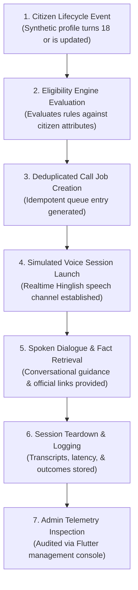
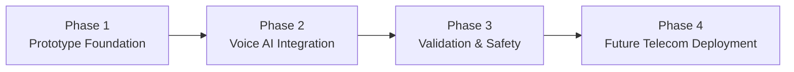

# Bharat Assist

> **AI-Powered, Voice-First Proactive Government Services Assistant for India**

[](#project-status-and-contribution)
[](#proposed-solution)
[](#core-features)
[](TECH.md)

---

## Navigation & Technical Documentation

This document covers the **product vision, citizen use cases, conversational capabilities, and operational workflows** for Bharat Assist.

For in-depth technical implementation specifications—including system architecture diagrams, database schemas, proposed REST and WebSocket API endpoints, voice streaming mechanics, setup guides, and security protocols—please refer directly to:

👉 **[TECH.md](TECH.md) — Complete Technical & Architecture Documentation**

---

## A. Project Introduction

**Bharat Assist** is an AI-powered, voice-first public service assistant designed to proactively connect Indian citizens with statutory government documents, welfare schemes, and civic entitlements.

### Why Voice-First Matters for India

India's digital public infrastructure has expanded rapidly over the past decade through platforms like Aadhaar, DigiLocker, Parivahan Sewa, and the National Voter's Service Portal. However, millions of citizens still encounter steep barriers when attempting to access these benefits:

- **The Digital Literacy Barrier**: Many citizens who own basic feature phones or shared family smartphones find multi-step web forms, CAPTCHA challenges, OTP flows, and multi-tier menu hierarchies intimidating.
- **The Information Discovery Deficit**: Citizens often only learn about essential government schemes—such as voter registration, learner's driving licences, educational scholarships, or welfare pensions—months or years after they become eligible, frequently missing critical application windows.
- **Linguistic Reality**: Everyday communication across Indian households occurs in fluid vernaculars and code-switched dialogues (such as **Hinglish**—Hindi interwoven with everyday English terms like *form*, *date of birth*, *licence*, *website*, and *portal*). Traditional automated telephone helplines rely on formal, rigid scripts that fail to understand natural colloquial phrasing.

Bharat Assist bridges this divide by delivering a **proactive, natural spoken dialogue**. Instead of requiring a citizen to search unfamiliar websites, the system identifies life milestones—such as turning 18 years old—and conducts a simulated, natural voice conversation in Hinglish to explain what documents they qualify for, what papers they need, and where to apply officially.

---

## B. Problem Statement

Navigating government services in India presents four recurring challenges for everyday citizens:

1. **Awareness & Timeliness**: Citizens are rarely informed automatically when they qualify for a new entitlement or civic obligation (e.g., enrolling on the electoral roll at age 18, applying for a learner's driving permit, or linking statutory identities).
2. **Procedural Complexity**: Official notification gazettes and departmental circulars are written in formal administrative vocabulary that is difficult for non-specialists to interpret.
3. **Misinformation & Middlemen Exploitation**: Unofficial third-party portals, fraudulent cyber-café operators, and touts frequently charge exorbitant illegal fees for services that the government provides free or at nominal statutory charges.
4. **Rigid Helplines**: Existing Interactive Voice Response (IVR) helplines force callers through cumbersome numeric menus (*"Press 1 for Hindi, Press 2 for Services..."*), offering zero tolerance for follow-up questions, speech interruptions, or spontaneous topic changes.

---

## C. Proposed Solution

Bharat Assist introduces an **event-driven, conversational voice assistance model**:

```
[ Citizen Lifecycle Event (e.g., Citizen Turns 18) ]
                        │
                        ▼
         [ Eligibility Evaluation Engine ]
                        │
                        ▼
      [ Deduplicated Simulated Outbound Call ]
                        │
                        ▼
    [ Real-Time Conversational Voice Session ]
  ├── Conducted in natural, colloquial Hinglish
  ├── Allows speech interruptions (barge-in) at any time
  ├── Supports natural topic switching (e.g., Voter ID ⇄ Driving Licence)
  └── Grounded strictly in verified official government data
```

By pairing lifecycle event detection with natural conversational voice intelligence, Bharat Assist transforms government service delivery from a **passive, pull-based search chore** into a **proactive, push-based civic advisory service**.

---

## D. Core Features

The following matrix documents the core features of Bharat Assist. In strict accordance with the current repository status (which contains design specifications and documentation prior to code scaffolding), all features are marked with their actual implementation state:

| # | Feature | Status | Description & Repository Evidence |
| :-: | :--- | :---: | :--- |
| **1** | **Synthetic Citizen Management** | **Planned** | Management of 100 fictional Indian citizen records with realistic demographic and regional attributes for safe simulation. |
| **2** | **Age & Profile Updates** | **Planned** | Mechanisms to advance simulation dates or edit a fictional citizen's date of birth to trigger milestone events. |
| **3** | **Age-Related Event Detection** | **Planned** | Event detection worker that identifies when a citizen crosses statutory milestones (e.g., reaching 18 years of age). |
| **4** | **Government-Service Eligibility Evaluation** | **Planned** | Programmatic rule engine evaluating qualification across schemes (Voter ID, Learner's Licence, PAN verification). |
| **5** | **Simulated Outbound-Call Triggering** | **Planned** | Dispatcher generating simulated voice calls to test devices or in-browser audio players upon milestone detection. |
| **6** | **Natural Real-Time Hinglish Voice Conversations** | **Planned** | Low-latency speech-to-speech interaction supporting natural Hindi-English code-switching and cultural honorifics. |
| **7** | **Interruption Handling & Turn-Taking** | **Planned** | Sub-second voice activity detection (barge-in) enabling callers to interrupt the AI naturally without desynchronization. |
| **8** | **Government-Domain Topic Switching** | **Planned** | Context-preserving dialogue manager allowing callers to switch freely between government schemes in a single session. |
| **9** | **Service Guidance (Aadhaar, Voter ID, Driving Licence)** | **Planned** | Plain-language guidance on application procedures, required supporting documents, and statutory fees. |
| **10** | **Verified Information & Official Portal Retrieval** | **Planned** | Strict grounding in curated official government data sources (UIDAI, ECI, Parivahan) to prevent hallucinations. |
| **11** | **Call Status, Transcripts, & Event History** | **Planned** | End-to-end audit logging of call connection status, spoken transcripts, latency telemetry, and resolution outcomes. |
| **12** | **Flutter Administration Dashboard** | **Planned** | Unified administrative interface for inspecting citizen records, triggering simulations, and monitoring live call queues. |
| **13** | **Error Handling & Duplicate-Event Prevention** | **Planned** | Idempotency key tracking and retry back-off policies ensuring no duplicate calls are generated for the same milestone. |

> [!NOTE]
> *Status Classification Guide*:
> - **Implemented**: Fully written, tested, and verifiable in repository code.
> - **In Progress**: Active code branches or partial implementations present.
> - **Planned**: Architectural design, schema, and API specification documented, awaiting codebase scaffolding.

---

## E. Real-World Use Cases

The following concrete operational scenarios illustrate how Bharat Assist behaves across diverse citizen interactions:

### Use Case 1: Milestone Outreach (Citizen Reaches Age 18)
- **Trigger**: The simulation clock advances or an administrator updates synthetic citizen Aarav Sharma's date of birth, crossing the 18-year statutory threshold.
- **System Behaviour**: The backend eligibility engine detects the milestone, qualifies Aarav for Voter Registration (ECI Form 6) and a Learner's Driving Licence (Parivahan), creates an idempotent call job, and initiates a simulated outbound voice call.
- **Expected Outcome**: The simulated phone rings. When answered, the assistant introduces itself transparently as an AI assistant from Bharat Assist, congratulates Aarav on turning 18, and informs him that he is now eligible to apply for his Voter ID and Learner's Licence.

### Use Case 2: Fluid Cross-Service Topic Switching
- **Trigger**: During a conversation regarding Aadhaar address update requirements, the citizen spontaneously asks: *"Achha, driving licence banwane ke liye test kahan dena hota hai?"*
- **System Behaviour**: The conversational engine detects the shift in topic from UIDAI Aadhaar services to MoRTH Parivahan services. It maintains the user's demographic context without requiring a restart or menu navigation.
- **Expected Outcome**: The assistant acknowledges the transition smoothly (*"Driving licence ke baare mein bhi bata deta hoon..."*), explains that the learner's test can often be taken online on Parivahan Sewa while the permanent driving test occurs at the local RTO, and asks if they want to review the required documents.

### Use Case 3: Official Portal & Anti-Fraud Verification
- **Trigger**: A citizen mentions that an internet café operator requested ₹500 to submit an online Voter ID application.
- **System Behaviour**: The assistant references verified statutory records from the Election Commission of India knowledge base.
- **Expected Outcome**: The assistant informs the citizen that submitting Form 6 on the official ECI portal (`voters.eci.gov.in`) or the Voter Helpline App is completely **free of cost**, warns against paying unauthorized third parties, and offers to explain the direct online steps.

### Use Case 4: Simplifying Bureaucratic Document Jargon
- **Trigger**: The citizen expresses confusion over technical requirements: *"Ye 'Proof of Ordinary Residence' ka matlab kya hota hai? Mere paas koi gazetted officer ka sign nahi hai."*
- **System Behaviour**: The assistant's vernacular clarification layer translates statutory legal requirements into everyday household examples.
- **Expected Outcome**: The assistant reassures the citizen in simple Hinglish that a gazetted officer's signature is not mandatory if they have common alternatives—such as an electricity bill in their family's name, a water bill, a bank passbook, or a current rent agreement.

### Use Case 5: Polite Boundary Enforcement & Redirection
- **Trigger**: The caller asks an out-of-scope question: *"Agle mahine cricket match kaun jeetega?"* or asks for political opinions.
- **System Behaviour**: The domain guardrail detects that the query falls outside government welfare services and civic documentation.
- **Expected Outcome**: The assistant politely declines with empathy and redirects the caller back to government services: *"Main cricket ya rajneeti par charcha nahi kar sakta, lekin agar aapko Voter ID, Ration Card ya kisi sarkari yojana ke baare mein jankari chahiye, toh main zaroor madad kar sakta hoon."*

### Use Case 6: Dynamic Propagation of Updated Service Rules
- **Trigger**: A government department updates statutory rules (e.g., Parivahan introduces contactless Aadhaar-based authentication for Learner's Licences, removing the physical RTO visit requirement).
- **System Behaviour**: The administrator updates the verified knowledge base record for `LEARNERS_LICENCE_MORTH`.
- **Expected Outcome**: In all subsequent voice calls, the assistant immediately quotes the updated procedure—explaining that if their Aadhaar is linked to their mobile number, they can take the online learner's test from home without visiting the RTO.

### Use Case 7: Call Failure, Retries, and Duplicate Prevention
- **Trigger**: A simulated outbound call encounters a busy signal, network drop, or goes unanswered.
- **System Behaviour**: The call dispatcher catches the failure event, updates the call job status to `RETRY_SCHEDULED`, increments the retry counter, and checks the idempotency key.
- **Expected Outcome**: The system does not spawn a new job. It schedules a retry after an exponential back-off window (e.g., 15 minutes). If the maximum retry threshold (e.g., 2 attempts) is exceeded, the job is marked `FAILED_EXHAUSTED` and logged in the audit trail without harassing the citizen.

---

## F. End-to-End Workflow

The complete operational lifecycle of Bharat Assist unfolds in seven clear stages:



1. **Lifecycle Event Ingestion**: A synthetic citizen's profile reaches an eligibility milestone (e.g., age 18) either through scheduled time advancement or administrator testing.
2. **Eligibility Evaluation**: The backend rule engine matches the citizen's age, location, and existing documents against statutory scheme rules.
3. **Deduplicated Job Queuing**: A single outbound call job is scheduled with an idempotency key to prevent repeat calls.
4. **Voice Session Initialization**: The voice orchestrator opens a simulated real-time audio session configured with cultural context and domain guidelines.
5. **Interactive Spoken Guidance**: The citizen and the AI converse in Hinglish. The citizen can interrupt, ask for simpler explanations, and explore multiple schemes.
6. **Telemetry & Transcript Archiving**: When the call concludes, the audio state, text transcript, recognized intent, and resolution status are written to the audit log.
7. **Administrative Review**: Operators inspect call outcomes, review transcripts, and verify system performance via the Flutter dashboard.

---

## G. Example Conversation

The following dialogue illustrates a typical real-time conversation between Bharat Assist and a newly eligible fictional citizen:

> **AI Assistant**: *"Namaste Aarav ji! Main Bharat Assist se bol raha hoon, ek automated AI government service sahayak. Aap 18 saal ke ho gaye hain, isliye main aapko badhai dene aur do zaroori sarkari dastavezon ke baare mein batane ke liye call kar raha hoon."*
>
> **Citizen (Aarav)**: *"Haan ji namaste. Kaunse dastavej?"*
>
> **AI Assistant**: *"Pehla hai aapka Voter ID card, jisse aap aane wale elections mein vote daal sakte hain. Aur doosra hai Learner's Driving Licence. Kya aap inke baare mein janna chahte hain?"*
>
> **Citizen (Aarav)**: *"Voter ID ke liye toh mujhe cyber café jana padega na? Wahan ₹300 mang rahe the."*
>
> **AI Assistant**: *"Nahi Aarav ji, cyber café par paise dene ki bilkul zaroorat nahi hai. Election Commission of India ke official portal `voters.eci.gov.in` par Form 6 bharna bilkul muft (free) hai. Aap apne phone se hi photo aur age proof upload karke apply kar sakte hain."*
>
> **Citizen (Aarav)** *(interrupting)*: *"Achha rukiye! Lekin mere paas abhi Voter ID nahi hai, toh kya main Driving Licence ke liye apply kar sakta hoon?"*
>
> **AI Assistant**: *"Ji bilkul! Driving Licence ke liye Voter ID zaroori nahi hai. Agar aapke paas Aadhaar Card hai, toh aap Parivahan portal `parivahan.gov.in` par jakar Learner's Licence ke liye online test de sakte hain. Kya aapka mobile number aapke Aadhaar se linked hai?"*
>
> **Citizen (Aarav)**: *"Haan, linked hai."*
>
> **AI Assistant**: *"Tab toh bohot aasan hai. Aap bina RTO jaye ghar baithe online Learner's Licence test de sakte hain. Iski sarkari fees lagbhag ₹150 se ₹200 hoti hai jo directly portal par pay hoti hai. Kya main aapke phone par in dono official websites ke links bhej doon?"*
>
> **Citizen (Aarav)**: *"Haan, bhej dijiye. Bohot shukriya aapka!"*
>
> **AI Assistant**: *"Aapka swagat hai Aarav ji. Kisi bhi anjaan vyakti ko extra paise na dein. Shubh din!"*

---

## H. Prototype Boundaries & Responsible AI

To ensure ethical design, transparency, and safety, Bharat Assist operates under explicit structural constraints:

- **100% Synthetic Records**: The system uses only 100 generated fictional citizen profiles. It does not store, process, or link to real citizen Personally Identifiable Information (PII).
- **Simulated Outbound Calls**: All calls are simulated within a local test harness or browser audio player. The system does not dial live telephone numbers on the public switched telephone network (PSTN).
- **No National Database Access**: Bharat Assist does not possess integration, access credentials, or connections to UIDAI Aadhaar, the National Population Register, or state databases.
- **Independent Proof of Concept**: This project is an independent architectural prototype. It is **not** an official government service, is not endorsed by the Government of India, and is not affiliated with any ministry.
- **Transparent AI Identity**: The voice assistant identifies itself as an automated AI system in its opening sentence to prevent caller confusion.
- **Future Production Prerequisites**: Any eventual deployment over actual telecom networks will mandate explicit citizen opt-in consent, integration with authorized Telecom Commercial Communications Customer Preference Regulations (TCCCPR) DND registries, and formal statutory approvals.

---

## I. Project Roadmap



### Phase 1: Prototype Foundation (Current Focus)
- [x] Product vision, use case definitions, and conversational architecture (`README.md`).
- [x] Technical architecture, database schemas, and API design specifications ([`TECH.md`](TECH.md)).
- [ ] Database schema creation for 7 core entities in Supabase / PostgreSQL.
- [ ] Synthetic dataset generation containing 100 fictional Indian citizen records.
- [ ] Rule-based eligibility engine for Voter ID and Learner's Licence services.

### Phase 2: Voice Integration & Administration
- [ ] Bidirectional WebSocket bridge for real-time speech-to-speech interaction.
- [ ] Natural Hinglish system prompt engineering with domain guardrails.
- [ ] Sub-second Voice Activity Detection (VAD) for natural interruption handling.
- [ ] Flutter administrative dashboard for simulation control and call queue visualization.

### Phase 3: Validation, Testing & Safety Evals
- [ ] Automated testing suite for age calculation boundaries and call deduplication.
- [ ] Conversational safety evaluations (anti-hallucination, scam warnings, polite boundary refusals).
- [ ] Audio latency profiling and transcript accuracy logging.

### Phase 4: Future Telecom & Public Scale
- [ ] Integration with Government of India's Project Bhashini for 22 scheduled regional languages.
- [ ] Inbound citizen helpline capabilities.
- [ ] Authorized Indian CPaaS telephony integration with TRAI/DoT regulatory compliance.
- [ ] Post-call automated SMS / WhatsApp dispatches containing official portal links.

---

## J. Project Status and Contribution

### Current Repository Status
Bharat Assist is currently in the **architectural design and prototype specification stage**. The repository contains comprehensive product documentation ([`README.md`](README.md)) and technical design blueprints ([`TECH.md`](TECH.md)). Source code scaffolding for the FastAPI backend, Supabase database, and Flutter frontend will follow according to the [Roadmap](#i-project-roadmap).

### How to Follow & Contribute
- **Documentation First**: Review [`TECH.md`](TECH.md) to understand the planned system components, database schemas, and API specifications.
- **Issue Tracking & Discussions**: Propose additional government scheme rules, regional language considerations, or conversational test scenarios via repository issues.
- **No Production Release**: Please note that there are currently no release binaries, public Docker containers, or live telephone numbers available.

### Licensing
No license has been selected yet for this repository. All rights are reserved pending licensing determination. A formal license file will be added to the repository root once an open-source or permissive license is selected.

---

*For technical architecture, data schemas, and API specifications, continue to [TECH.md](TECH.md).*
