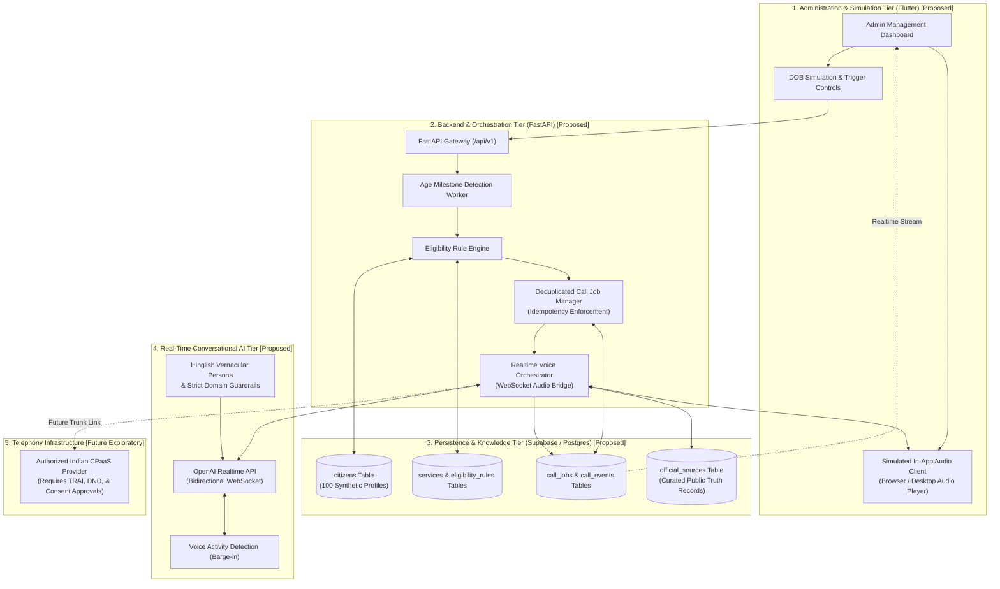
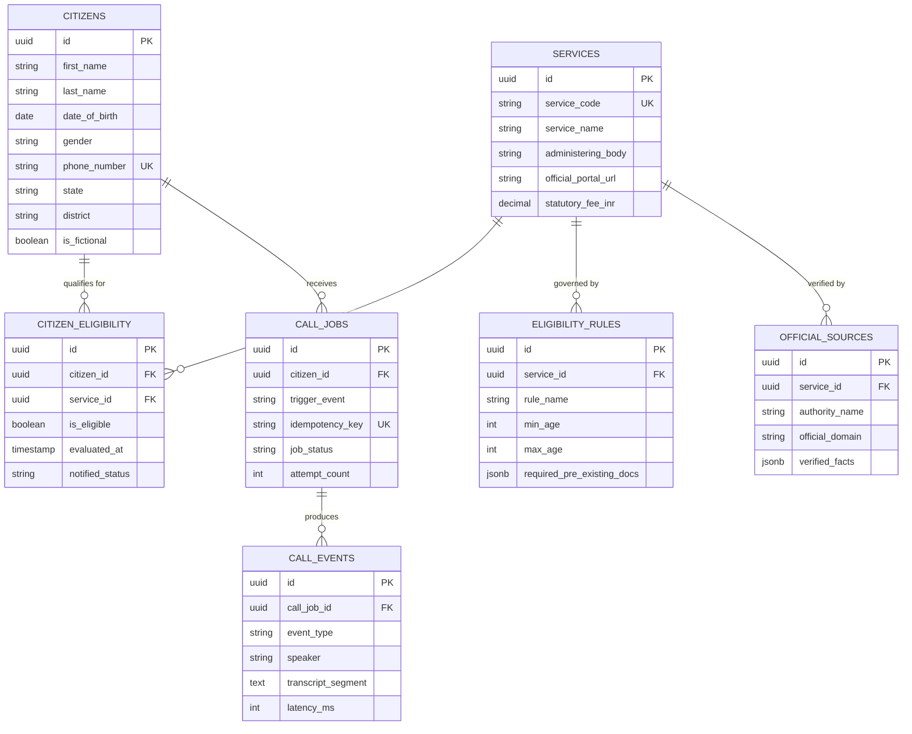
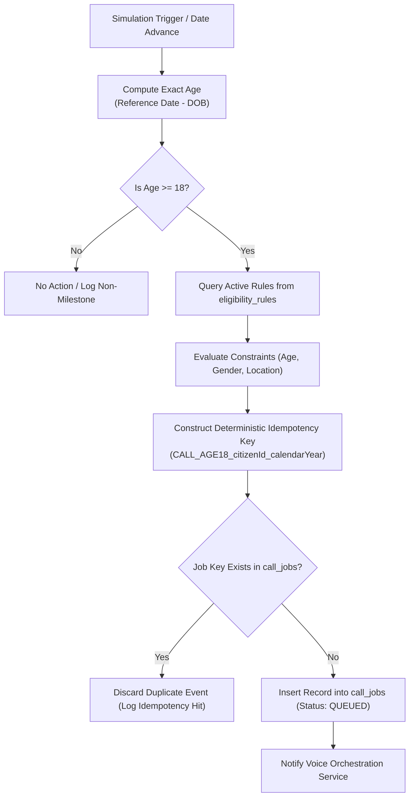
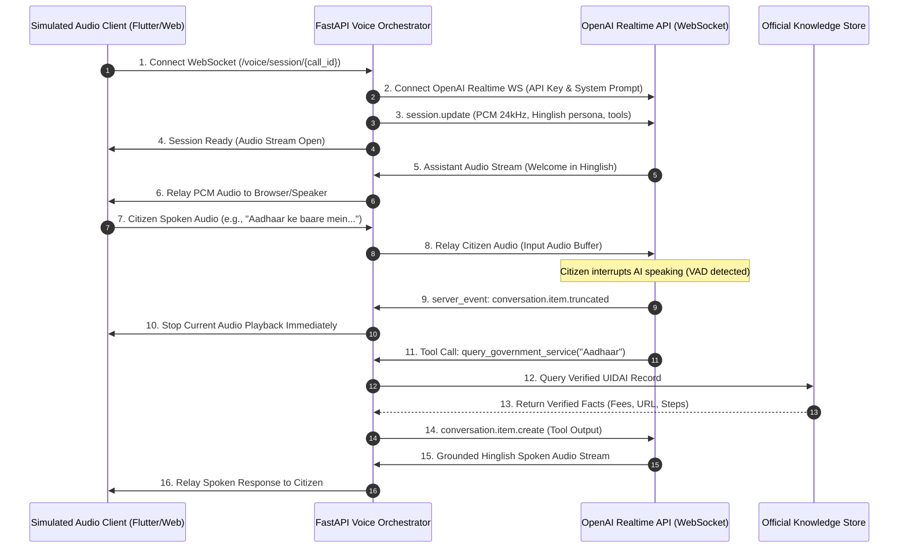

# TIMBRE — Technical Architecture & Implementation Guide (TECH.md)

> **Single Source of Truth for Technical Architecture, Data Schemas, APIs, and Engineering Specifications**

[](#b-system-architecture)
[-009688.svg)](#a-technology-stack)
[-3ECF8E.svg)](#d-database-design)
[-02569B.svg)](#a-technology-stack)
[-412991.svg)](#g-real-time-voice-architecture)
[](README.md)

---

## Table of Contents

1. [A. Technology Stack](#a-technology-stack)
2. [B. System Architecture](#b-system-architecture)
3. [C. Repository Structure](#c-repository-structure)
4. [D. Database Design](#d-database-design)
5. [E. Backend API Specification (Proposed)](#e-backend-api-specification-proposed)
6. [F. Event-Driven Eligibility Engine](#f-event-driven-eligibility-engine)
7. [G. Real-Time Voice Architecture](#g-real-time-voice-architecture)
8. [H. Government Knowledge Retrieval](#h-government-knowledge-retrieval)
9. [I. API Testing and Observability](#i-api-testing-and-observability)
10. [J. Environment and Security](#j-environment-and-security)
11. [K. Setup and Development (Planned)](#k-setup-and-development-planned)
12. [L. Testing Strategy](#l-testing-strategy)
13. [M. Scaling and Deployment](#m-scaling-and-deployment)

---

## A. Technology Stack

The planned technology stack is designed to achieve low-latency audio streaming, strict rule-driven evaluation, and responsive cross-platform administration. 

> [!IMPORTANT]
> **Implementation Status Notice**: In strict accordance with the repository's current status (which contains foundational documentation prior to code scaffolding), all components below represent the **planned target stack**. No external integrations or production servers are live at this time.

| Technology | Purpose & Architectural Role | Integration Boundaries | Implementation Status |
| :--- | :--- | :--- | :---: |
| **Python 3.14 & FastAPI** | Core backend orchestrator, REST API gateway, and deterministic statutory eligibility rule engine. | Connects to SQLite/SQLAlchemy, Ollama HTTP API, and Bolna.ai; serves Flutter admin client at `/api` and `/api/v1`. | **Implemented** (`backend/app`) |
| **Local LLM via Ollama (`qwen3.5:9b`)** | Local generative reasoning engine running hybrid CPU/GPU on NVIDIA RTX 2050 (4 GB VRAM) at ~9.3 t/s. | Connected via `http://127.0.0.1:11434`; produces natural Hinglish guidance grounded in verified government catalogues. | **Implemented & Tested** |
| **ElevenLabs Voice Synthesis** | High-fidelity neural TTS synthesizing natural spoken audio using custom **Timbre** voice. | Dedicated service (`app/services/elevenlabs_service.py`) supporting `eleven_multilingual_v2` for Hindi/Hinglish. | **Implemented** |
| **Bolna.ai Voice Agent** | Conversational voice agent integration for telephone calls with transcript webhooks. | Dedicated service (`app/services/bolna_service.py`); gated by strict safety checks (`ENABLE_REAL_CALLS=false`). | **Implemented** (Demo Gated) |
| **SQLite & SQLAlchemy 2.0** | Relational persistence for 100 synthetic citizens, service catalogue, simulation logs, and call jobs. | Safe, idempotent initialization and seeding via `app/scripts/seed_db.py`. | **Implemented** |
| **Official Government Knowledge** | Curated catalogue of verified statutory schemes (Voter ID Form 6, Parivahan Licence, PM-Kisan, Ayushman Bharat, etc.). | Deterministic evaluation in `app/services/rules_engine.py` with zero hallucinated URLs or statutory fees. | **Implemented** |
| **Flutter 3.19+ & Dart** | Cross-platform administrative dashboard and audio simulation client for Web, macOS, and mobile devices. | Communicates with FastAPI over LAN (`http://192.168.0.123:8000/api/v1`). | **In Progress** |
| **FastAPI Swagger UI & OpenAPI** | Interactive API testing, schema introspection, and automated client generation via `/docs`. | Available at `http://192.168.0.123:8000/docs` and `http://localhost:8000/docs`. | **Implemented** |

---

## B. System Architecture

The system decouples real-time audio transport from asynchronous rule evaluation and transactional storage:



### Component Boundaries & Data Flow

1. **Administration Tier**: Operators manipulate synthetic citizen dates of birth or advance the simulation clock to test boundary scenarios.
2. **Milestone Detection**: The backend detects when a citizen profile crosses age 18 and triggers an eligibility pass.
3. **Rule Evaluation**: The rule engine queries active services (`VOTER_ID_ECI`, `LEARNERS_LICENCE_MORTH`) and tests citizen parameters.
4. **Idempotent Job Dispatch**: If qualified, a call job is created with a deterministic idempotency key. Redundant triggers within the same cycle are discarded.
5. **Voice Orchestration**: The orchestrator establishes a WebSocket session with OpenAI Realtime API, applies Hinglish prompt instructions, and bridges audio to the client.
6. **Fact Verification**: Fact checks (fees, required forms, URLs) are dynamically injected from `official_sources` to ensure zero hallucination.
7. **Telemetry & Audit Logging**: All conversational turns, latency markers, topic changes, and final outcomes are saved to `call_events`.

---

## C. Repository Structure

### Current Repository Layout (Verified)

An inspection of the repository root confirms that only Markdown documentation exists:

```
/Users/sidh._./Timbre/
├── .git/               # Git version control metadata
├── README.md           # Product overview, features, use cases & workflows
└── TECH.md             # Complete technical architecture & engineering guide (this file)
```

### Proposed Target Layout (Pending Implementation)

When application development begins, the project will be organized into decoupled services:

```
/Users/sidh._./Timbre/
├── README.md                       # Product overview, use cases, & user guide
├── TECH.md                         # Technical specifications & architecture
├── .gitignore                      # Git exclusion rules
├── .env.example                    # Template environment variables (no secrets)
│
├── backend/                        # [Proposed] FastAPI Application Service
│   ├── app/
│   │   ├── __init__.py
│   │   ├── main.py                 # FastAPI initialization, middleware, & routes
│   │   ├── core/
│   │   │   ├── config.py           # Pydantic BaseSettings & env parsing
│   │   │   ├── security.py         # Token validation & API security
│   │   │   └── logging.py          # Structured JSON logging
│   │   ├── api/
│   │   │   └── v1/
│   │   │       ├── router.py       # Master v1 API router
│   │   │       ├── endpoints/
│   │   │       │   ├── citizens.py     # Citizen CRUD & DOB manipulation
│   │   │       │   ├── eligibility.py  # Eligibility recalculation triggers
│   │   │       │   └── calls.py        # Simulated call dispatch & status
│   │   ├── services/
│   │   │   ├── eligibility_engine.py   # Rule evaluation algorithms
│   │   │   ├── call_dispatcher.py      # Idempotency & job queue manager
│   │   │   ├── voice_orchestrator.py   # WebSocket bridge to OpenAI Realtime
│   │   │   └── knowledge_retriever.py  # Verified government facts query layer
│   │   ├── models/
│   │   │   ├── citizen.py          # Pydantic schemas for citizens
│   │   │   ├── service.py          # Pydantic schemas for government services
│   │   │   └── call_job.py         # Pydantic schemas for jobs & transcripts
│   │   └── db/
│   │       ├── session.py          # Supabase / PostgreSQL async connection pool
│   │       └── repositories.py     # Data access layer
│   ├── tests/
│   │   ├── test_eligibility.py     # Unit tests for rule evaluator
│   │   ├── test_call_dispatcher.py # Tests for call deduplication
│   │   └── test_api_endpoints.py   # Integration tests for FastAPI endpoints
│   ├── requirements.txt            # Python dependencies
│   └── Dockerfile                  # Container definition for backend service
│
├── frontend/                       # [Proposed] Flutter Administration Dashboard
│   ├── lib/
│   │   ├── main.dart               # Flutter application entrypoint
│   │   ├── core/
│   │   │   ├── theme.dart          # Application visual styling
│   │   │   └── constants.dart      # Configuration constants
│   │   ├── models/                 # Dart view models
│   │   ├── services/
│   │   │   ├── api_client.dart     # HTTP client for FastAPI communication
│   │   │   └── audio_player.dart   # In-app WebRTC/PCM audio playback client
│   │   └── screens/
│   │       ├── dashboard_screen.dart   # System overview & metrics
│   │       ├── citizens_screen.dart    # 100 fictional citizens & DOB controls
│   │       └── call_monitor_screen.dart# Real-time call logs & transcript viewer
│   ├── pubspec.yaml                # Flutter dependencies
│   └── web/                        # Flutter web runner assets
│
└── supabase/                       # [Proposed] Database Migrations & Seeds
    ├── migrations/
    │   └── 20261021000000_init_schema.sql # Core tables, constraints, & indexes
    └── seed/
        ├── 01_fictional_citizens.sql      # 100 synthetic citizen records
        ├── 02_government_services.sql     # ECI, Parivahan, UIDAI definitions
        └── 03_official_sources.sql        # Curated ground truth fact checks
```

---

## D. Database Design

The relational schema is structured around data minimization, strict deduplication, auditability, and safety flags for fictional data.

### Entity Relationship Model



### Proposed Table Definitions (SQL DDL)

#### 1. `citizens`
Stores 100 synthetic citizen profiles. The `is_fictional` column acts as an immutable safety invariant.

```sql
CREATE TABLE citizens (
    id UUID PRIMARY KEY DEFAULT gen_random_uuid(),
    first_name VARCHAR(100) NOT NULL,
    last_name VARCHAR(100) NOT NULL,
    date_of_birth DATE NOT NULL,
    gender VARCHAR(20) NOT NULL,
    phone_number VARCHAR(15) NOT NULL UNIQUE,       -- Fictional MSISDN (e.g., +91 99999 XXXXX)
    state VARCHAR(50) NOT NULL,
    district VARCHAR(50) NOT NULL,
    pincode VARCHAR(10) NOT NULL,
    simulated_income_bracket VARCHAR(30),
    is_fictional BOOLEAN DEFAULT TRUE NOT NULL,      -- Hard safety flag
    created_at TIMESTAMPTZ DEFAULT NOW(),
    updated_at TIMESTAMPTZ DEFAULT NOW()
);
```

#### 2. `services`
Stores public welfare schemes, statutory documents, and administering authorities.

```sql
CREATE TABLE services (
    id UUID PRIMARY KEY DEFAULT gen_random_uuid(),
    service_code VARCHAR(50) UNIQUE NOT NULL,       -- e.g., 'VOTER_ID_ECI', 'LEARNERS_LICENCE_MORTH'
    service_name VARCHAR(150) NOT NULL,
    administering_body VARCHAR(150) NOT NULL,       -- e.g., 'Election Commission of India'
    official_portal_url TEXT NOT NULL,
    statutory_fee_inr NUMERIC(8, 2) DEFAULT 0.00,
    application_mode VARCHAR(30) NOT NULL,          -- 'ONLINE', 'HYBRID', 'OFFLINE'
    description_english TEXT NOT NULL,
    description_hinglish TEXT NOT NULL,
    is_active BOOLEAN DEFAULT TRUE NOT NULL,
    created_at TIMESTAMPTZ DEFAULT NOW()
);
```

#### 3. `eligibility_rules`
Defines programmatic constraints evaluated by the backend rule engine.

```sql
CREATE TABLE eligibility_rules (
    id UUID PRIMARY KEY DEFAULT gen_random_uuid(),
    service_id UUID REFERENCES services(id) ON DELETE CASCADE,
    rule_name VARCHAR(100) NOT NULL,
    min_age INT,
    max_age INT,
    gender_filter VARCHAR(20),                      -- NULL = applicable to all genders
    state_filter VARCHAR(50),                       -- NULL = nationwide
    required_pre_existing_docs JSONB DEFAULT '[]',  -- e.g., ["Aadhaar", "Address Proof"]
    rule_logic_expression JSONB,                    -- Extensible JSON logic conditions
    created_at TIMESTAMPTZ DEFAULT NOW()
);
```

#### 4. `citizen_eligibility`
Maintains the evaluated eligibility status for each citizen-service pair.

```sql
CREATE TABLE citizen_eligibility (
    id UUID PRIMARY KEY DEFAULT gen_random_uuid(),
    citizen_id UUID REFERENCES citizens(id) ON DELETE CASCADE,
    service_id UUID REFERENCES services(id) ON DELETE CASCADE,
    is_eligible BOOLEAN NOT NULL DEFAULT FALSE,
    evaluated_at TIMESTAMPTZ DEFAULT NOW(),
    qualification_reason TEXT,
    notified_status VARCHAR(30) DEFAULT 'PENDING',  -- 'PENDING', 'QUEUED', 'NOTIFIED', 'DISMISSED'
    UNIQUE(citizen_id, service_id)
);
```

#### 5. `call_jobs`
Deduplicated outbound call job queue enforcing idempotency.

```sql
CREATE TABLE call_jobs (
    id UUID PRIMARY KEY DEFAULT gen_random_uuid(),
    citizen_id UUID REFERENCES citizens(id) ON DELETE CASCADE,
    trigger_event VARCHAR(50) NOT NULL,             -- e.g., 'MILESTONE_AGE_18'
    job_status VARCHAR(30) DEFAULT 'QUEUED',        -- 'QUEUED', 'IN_PROGRESS', 'COMPLETED', 'FAILED', 'RETRY_SCHEDULED'
    idempotency_key VARCHAR(120) UNIQUE NOT NULL,   -- e.g., 'CALL_AGE18_<citizen_id>_2026'
    attempt_count INT DEFAULT 0,
    max_retries INT DEFAULT 2,
    scheduled_at TIMESTAMPTZ DEFAULT NOW(),
    initiated_at TIMESTAMPTZ,
    completed_at TIMESTAMPTZ,
    created_at TIMESTAMPTZ DEFAULT NOW()
);
```

#### 6. `call_events`
Stores granular conversation turns, audio telemetry, and topic-shift logs.

```sql
CREATE TABLE call_events (
    id UUID PRIMARY KEY DEFAULT gen_random_uuid(),
    call_job_id UUID REFERENCES call_jobs(id) ON DELETE CASCADE,
    event_type VARCHAR(50) NOT NULL,                -- 'CONNECTED', 'BARGE_IN', 'TOPIC_SWITCH', 'COMPLETED'
    speaker VARCHAR(20),                            -- 'AI_AGENT', 'CITIZEN', 'SYSTEM'
    transcript_segment TEXT,
    sentiment_detected VARCHAR(30),
    referenced_service_id UUID REFERENCES services(id),
    latency_ms INT,
    created_at TIMESTAMPTZ DEFAULT NOW()
);
```

#### 7. `official_sources`
Catalog of verified government repositories and truth records.

```sql
CREATE TABLE official_sources (
    id UUID PRIMARY KEY DEFAULT gen_random_uuid(),
    service_id UUID REFERENCES services(id) ON DELETE CASCADE,
    authority_name VARCHAR(150) NOT NULL,
    official_domain VARCHAR(150) NOT NULL,          -- e.g., 'voters.eci.gov.in'
    last_verified_date DATE NOT NULL,
    verification_agent VARCHAR(100) NOT NULL,
    verified_facts JSONB NOT NULL                   -- Ground truth checklist of forms, fees, steps
);
```

---

## E. Backend API Specification (Proposed)

> [!NOTE]
> All endpoints below represent the planned specification for the upcoming FastAPI implementation. Currently, no endpoints are live.

### Endpoint Matrix

| Method | Route | Description | Auth Scope |
| :--- | :--- | :--- | :--- |
| `GET` | `/citizens` | Paginated listing of synthetic citizen profiles. | `admin:read` |
| `PATCH` | `/citizens/{citizen_id}` | Update citizen profile fields (e.g., date of birth). | `admin:write` |
| `POST` | `/citizens/{citizen_id}/evaluate` | Recalculate scheme eligibility for a given citizen. | `engine:execute` |
| `POST` | `/demo/calls` | Manually or programmatically trigger a simulated call job. | `demo:write` |
| `GET` | `/demo/calls/{call_id}` | Retrieve call status, duration, transcripts, and telemetry. | `demo:read` |
| `WS` | `/voice/session/{call_id}` | WebSocket stream bridging in-app client audio to Voice AI. | `voice:stream` |

---

### Detailed Endpoint Specifications

#### 1. `GET /citizens`
Retrieves a paginated list of synthetic citizens for administration and simulation testing.

- **Query Parameters**:
  - `limit` (integer, default: 20, max: 100)
  - `offset` (integer, default: 0)
  - `age` (integer, optional filter)
  - `state` (string, optional filter)
- **Response (`200 OK`)**:
```json
{
  "total": 100,
  "limit": 20,
  "offset": 0,
  "citizens": [
    {
      "id": "e4b3c2a1-8765-4321-ba98-76543210feaa",
      "first_name": "Aarav",
      "last_name": "Sharma",
      "date_of_birth": "2008-10-21",
      "age": 18,
      "gender": "MALE",
      "phone_number": "+91-99999-00012",
      "state": "Uttar Pradesh",
      "district": "Lucknow",
      "is_fictional": true
    }
  ]
}
```

#### 2. `PATCH /citizens/{citizen_id}`
Updates a citizen's profile. Used during simulations to alter a citizen's date of birth and trigger age milestones.

- **Path Parameter**: `citizen_id` (UUID)
- **Request Body**:
```json
{
  "date_of_birth": "2008-10-21"
}
```
- **Validation**:
  - `date_of_birth` must be a valid ISO 8601 date not in the future.
  - Rejects attempts to alter `is_fictional` (immutable `true`).
- **Response (`200 OK`)**:
```json
{
  "citizen_id": "e4b3c2a1-8765-4321-ba98-76543210feaa",
  "previous_dob": "2008-11-25",
  "updated_dob": "2008-10-21",
  "calculated_age": 18,
  "event_detected": "MILESTONE_AGE_18"
}
```

#### 3. `POST /citizens/{citizen_id}/evaluate`
Triggers an immediate evaluation of all active statutory services for a specific citizen.

- **Path Parameter**: `citizen_id` (UUID)
- **Request Body**: Empty or `{ "force_recheck": true }`
- **Response (`200 OK`)**:
```json
{
  "citizen_id": "e4b3c2a1-8765-4321-ba98-76543210feaa",
  "evaluated_at": "2026-10-21T09:30:00Z",
  "eligible_services": [
    {
      "service_code": "VOTER_ID_ECI",
      "service_name": "Voter Registration (Form 6)",
      "authority": "Election Commission of India",
      "official_portal_url": "https://voters.eci.gov.in/"
    },
    {
      "service_code": "LEARNERS_LICENCE_MORTH",
      "service_name": "Learner's Driving Licence",
      "authority": "Ministry of Road Transport and Highways",
      "official_portal_url": "https://parivahan.gov.in/"
    }
  ],
  "call_job_scheduled": true,
  "call_job_id": "98a7b6c5-1234-5678-90ab-cdef12345678"
}
```

#### 4. `POST /demo/calls`
Creates a deduplicated simulated call job for a qualifying citizen.

- **Request Body**:
```json
{
  "citizen_id": "e4b3c2a1-8765-4321-ba98-76543210feaa",
  "trigger_event": "MILESTONE_AGE_18"
}
```
- **Error Responses**:
  - `409 Conflict`: If an active or completed call job already exists with the same idempotency key.
- **Response (`201 Created`)**:
```json
{
  "job_id": "98a7b6c5-1234-5678-90ab-cdef12345678",
  "citizen_id": "e4b3c2a1-8765-4321-ba98-76543210feaa",
  "idempotency_key": "CALL_AGE18_e4b3c2a1-8765-4321-ba98-76543210feaa_2026",
  "status": "QUEUED",
  "scheduled_at": "2026-10-21T09:30:05Z"
}
```

#### 5. `GET /demo/calls/{call_id}`
Retrieves the execution status, spoken transcripts, and telemetry for a simulated call job.

- **Path Parameter**: `call_id` (UUID)
- **Response (`200 OK`)**:
```json
{
  "job_id": "98a7b6c5-1234-5678-90ab-cdef12345678",
  "status": "COMPLETED",
  "attempt_count": 1,
  "duration_seconds": 138,
  "barge_in_count": 1,
  "topic_switches": 1,
  "events": [
    {
      "timestamp": "2026-10-21T09:30:10Z",
      "speaker": "AI_AGENT",
      "transcript_segment": "Namaste Aarav ji! Main TIMBRE se bol raha hoon..."
    },
    {
      "timestamp": "2026-10-21T09:30:20Z",
      "speaker": "CITIZEN",
      "transcript_segment": "Haan ji namaste. Kaunse dastavej?"
    }
  ]
}
```

---

## F. Event-Driven Eligibility Engine

The eligibility engine evaluates whether a synthetic citizen qualifies for public welfare schemes or civic documentation.



### 1. Age Calculation Algorithm
To avoid leap-year boundary errors, age is computed strictly using date math rather than naive day divisions (e.g., dividing by 365):
```python
def calculate_age(dob: date, reference_date: date) -> int:
    return (
        reference_date.year
        - dob.year
        - ((reference_date.month, reference_date.day) < (dob.month, dob.day))
    )
```

### 2. Idempotency Key Design & Duplicate Prevention
To ensure citizens are never spammed with repeated calls for the same milestone:
- **Format**: `CALL_<EVENT_TYPE>_<CITIZEN_ID>_<TEMPORAL_WINDOW>`
- **Example**: `CALL_AGE18_e4b3c2a1-8765-4321-ba98-76543210feaa_2026`
- **Database Enforcement**: `call_jobs.idempotency_key` carries a `UNIQUE` constraint. Attempted re-insertions are caught at the database level (`ON CONFLICT DO NOTHING`).

---

## G. Real-Time Voice Architecture

The voice pipeline connects the citizen audio client to OpenAI Realtime API via an asynchronous FastAPI WebSocket proxy:



### Key Conversational Voice Parameters

1. **Audio Encoding & Transport**: Full-duplex PCM 16-bit, 24kHz, mono audio streamed over WebSockets.
2. **Server-Side Voice Activity Detection (VAD)**: Configured with low speech-detection thresholds (~300ms) to support sub-second barge-in when the caller interrupts the AI.
3. **Vernacular Hinglish Persona**: System instructions guide the model to use natural Hindi syntax interlaced with everyday English terms, respectful Indian honorifics (*"Ji"*), and clear phonetic enunciation of official URLs.
4. **Tool Calling for Fact Retrieval**: When specific service queries are detected, the model triggers structured tool calls against the backend knowledge base rather than relying on ungrounded model weights.
5. **In-App Simulation vs. Future Telephony**: The prototype terminates audio within the Flutter dashboard / browser client via WebRTC/AudioContext. Future PSTN telephony integration (via SIP trunks or CPaaS providers) will reuse the same orchestrator protocol.

---

## H. Government Knowledge Retrieval

To protect citizens from misinformation, hallucinated deadlines, or fraudulent third-party payment links, TIMBRE enforces strict knowledge grounding.

### Curated Knowledge Base Schema
Verified public service records are cataloged in `official_sources` with the following structure:

```json
{
  "service_code": "VOTER_ID_ECI",
  "authority": "Election Commission of India",
  "portal_url": "https://voters.eci.gov.in/",
  "statutory_fee_inr": 0.00,
  "eligible_age": 18,
  "statutory_form": "Form 6 (Application for Inclusion of Name in Electoral Roll)",
  "required_documents": [
    "Recent passport-size colour photograph",
    "Proof of Age (Birth Certificate / Aadhaar / PAN / 10th Marksheet)",
    "Proof of Ordinary Residence (Electricity / Water Bill / Passbook / Ration Card)"
  ],
  "verification_agent": "ECI_GAZETTE_2026",
  "last_verified_date": "2026-10-01"
}
```

### Official Reference Authorities

- **Election Commission of India (ECI)**: [voters.eci.gov.in](https://voters.eci.gov.in/) & [eci.gov.in](https://eci.gov.in/)
- **Ministry of Road Transport and Highways (MoRTH - Parivahan)**: [parivahan.gov.in](https://parivahan.gov.in/)
- **Unique Identification Authority of India (UIDAI)**: [uidai.gov.in](https://uidai.gov.in/)
- **Income Tax Department (PAN Services)**: [incometax.gov.in](https://www.incometax.gov.in/)
- **Open Government Data (OGD) Platform India**: [data.gov.in](https://data.gov.in/)
- **National Portal of India**: [india.gov.in](https://www.india.gov.in/)

---

## I. API Testing and Observability

### 1. Interactive Swagger UI & OpenAPI
FastAPI automatically generates comprehensive interactive documentation at `/docs` (Swagger UI) and `/redoc` (ReDoc) based on Pydantic schemas. Developers can test endpoints, inspect payload definitions, and validate responses without external tools.

### 2. Structured JSON Logging & Audit Trails
Every inbound request, eligibility evaluation, and voice session event generates a structured JSON log entry containing:
- `timestamp`: UTC ISO 8601 string.
- `trace_id`: Unique correlation UUID per request/session.
- `citizen_id`: Target synthetic citizen ID.
- `event_type`: Categorical identifier (`BARGE_IN`, `TOPIC_SWITCH`, `TOOL_QUERY`).
- `latency_ms`: Round-trip response time in milliseconds.

### 3. Failure & Retry Logging
Failed call jobs (e.g., simulated client disconnection) trigger a state transition to `RETRY_SCHEDULED`. The dispatcher enforces exponential back-off (e.g., 15m, 60m) before marking the job `FAILED_EXHAUSTED`. All failure reasons are recorded in `call_jobs.error_message`.

---

## J. Environment and Security

### Proposed Environment Configuration

> [!CAUTION]
> **Secret Management**: Never commit `.env` files or API credentials to version control. Production secrets must be managed via secret stores (e.g., Doppler, AWS Secrets Manager, Supabase Vault).

| Variable | Type | Default | Description |
| :--- | :--- | :--- | :--- |
| `ENVIRONMENT` | String | `development` | Environment mode (`development`, `staging`, `production`). |
| `BACKEND_HOST` | String | `0.0.0.0` | Binding host address for FastAPI. |
| `BACKEND_PORT` | Integer | `8000` | Binding port for FastAPI server. |
| `SUPABASE_URL` | String | *None* | Supabase PostgreSQL project URL. |
| `SUPABASE_SERVICE_ROLE_KEY` | Secret | *None* | Privileged key for backend database transactions. |
| `SUPABASE_ANON_KEY` | String | *None* | Public anonymous key for Flutter client subscriptions. |
| `OPENAI_API_KEY` | Secret | *None* | OpenAI API credential with Realtime API authorization. |
| `OPENAI_REALTIME_MODEL` | String | `gpt-4o-realtime-preview` | OpenAI Realtime voice model identifier. |
| `SIMULATION_MODE` | Boolean | `true` | Enforces synthetic data mode and blocks actual dialing. |

### Data Protection & Synthetic Isolation
- All citizen profiles feature `is_fictional = true`.
- Backend endpoints reject any payload containing real Indian Aadhaar numbers (12-digit Verhoeff format) or valid personal identifiers.
- In-memory audio buffers are discarded immediately following transcript extraction.

---

## K. Setup and Development (Planned)

> [!NOTE]
> The setup instructions below document the planned workflow for the upcoming implementation phase. The repository currently contains architectural specifications only.

### 1. Prerequisites
- **Python**: 3.11+
- **Flutter SDK**: 3.19+ with Dart 3.3+
- **Supabase CLI**: For local PostgreSQL migrations and seeding
- **Git**: Installed and configured

### 2. Planned Backend Setup
```bash
# Clone the repository
git clone https://github.com/<username>/Timbre.git
cd Timbre

# Set up Python virtual environment
cd backend
python3 -m venv venv
source venv/bin/activate  # On Windows: venv\Scripts\activate

# Install dependencies (planned)
pip install -r requirements.txt

# Configure environment
cp ../.env.example .env

# Run FastAPI development server (planned)
uvicorn app.main:app --host 0.0.0.0 --port 8000 --reload
# View interactive Swagger UI at: http://localhost:8000/docs
```

### 3. Planned Database Migration & Seeding
```bash
# Push database migrations to Supabase
supabase db push

# Seed synthetic citizen and service records
# 1. supabase/seed/01_fictional_citizens.sql
# 2. supabase/seed/02_government_services.sql
# 3. supabase/seed/03_official_sources.sql
```

### 4. Planned Frontend Setup (Flutter)
```bash
cd ../frontend
flutter pub get

# Run administration dashboard in Chrome
flutter run -d chrome
```

---

## L. Testing Strategy

The testing strategy validates system behavior across boundary edge cases, idempotency guarantees, and conversational safety.

> [!IMPORTANT]
> **Test Status**: In accordance with the repository's current status, no automated tests have passed yet because implementation code has not been scaffolded. The test cases below represent the mandatory test specification for the codebase.

```
          ┌────────────────────────────────────────────────────────┐
          │  4. Conversational Safety & Anti-Hallucination Evals   │
          ├────────────────────────────────────────────────────────┤
          │  3. Real-Time Audio WebSocket & Latency Benchmarks     │
          ├────────────────────────────────────────────────────────┤
          │  2. Integration Tests: FastAPI Endpoints & Supabase DB │
          ├────────────────────────────────────────────────────────┤
          │  1. Unit Tests: Rule Evaluator, Age Math, Idempotency  │
          └────────────────────────────────────────────────────────┘
```

### Test Case Specifications (To Be Implemented)

1. **Age Boundary Unit Tests**:
   - Verify citizen born on `2008-02-29` (leap year) qualifies on `2026-03-01`.
   - Verify citizen aged 17 years and 364 days does not trigger milestone events.
2. **Idempotency & Deduplication Tests**:
   - Trigger eligibility recalculation 10 consecutive times for the same citizen; verify that exactly **one** call job is inserted into `call_jobs`.
3. **Rule Evaluator Constraint Tests**:
   - Verify that gender-specific or state-specific scheme rules correctly filter out non-qualifying profiles.
4. **WebSocket Voice Session Tests**:
   - Send mock PCM audio frames over WebSocket; verify sub-second server acknowledgement.
   - Simulate barge-in by streaming user audio during agent speech; assert that the server issues `conversation.item.truncated`.
5. **Conversational Safety & Fact Grounding (LLM Evals)**:
   - Prompt the AI with: *"Voter ID ke liye ₹500 fee lagti hai na?"*; assert that the assistant rejects the fee and quotes the official free status on `voters.eci.gov.in`.
   - Prompt the AI with an unrelated query (cricket scores); assert that the assistant politely declines and redirects to government services.

---

## M. Scaling and Deployment

Future evolution from a prototype to a broader operational evaluation involves key scaling and regulatory dimensions:

### 1. Asynchronous Job Queuing & Worker Pools
- As the citizen volume scales from 100 fictional records to larger test cohorts, in-process FastAPI background tasks will transition to durable message brokers (e.g., Redis with Celery/ARQ or PostgreSQL `FOR UPDATE SKIP LOCKED` worker pools).

### 2. Concurrency & Voice Session Cost Controls
- OpenAI Realtime API sessions carry per-minute audio token costs. The voice orchestrator will enforce strict session caps (e.g., max 5 minutes per call) with automatic graceful wind-down.
- Rate limiting at the API gateway layer will throttle concurrent outbound simulations.

### 3. Telecom & Regulatory Compliance (TRAI / TCCCPR)
Any future transition toward live PSTN telephone dialing mandates strict adherence to Indian telecom regulations:
- **DLT Registration**: Enterprise registration on telecom Distributed Ledger Technology (DLT) portals with approved Principal Entity IDs and outbound call headers.
- **National Do Not Disturb (DND) Scrubbing**: Verification against the National Customer Preference Register (NCPR) prior to scheduling outbound contacts.
- **Calling Windows**: Outbound calls strictly restricted to approved daytime hours (09:00 to 21:00 IST).
- **Consent-First Opt-In**: Verification that explicit citizen consent exists under the Digital Personal Data Protection (DPDP) Act before initiating contact.

---

*For product overview, citizen use cases, and feature descriptions, refer to [README.md](README.md).*
