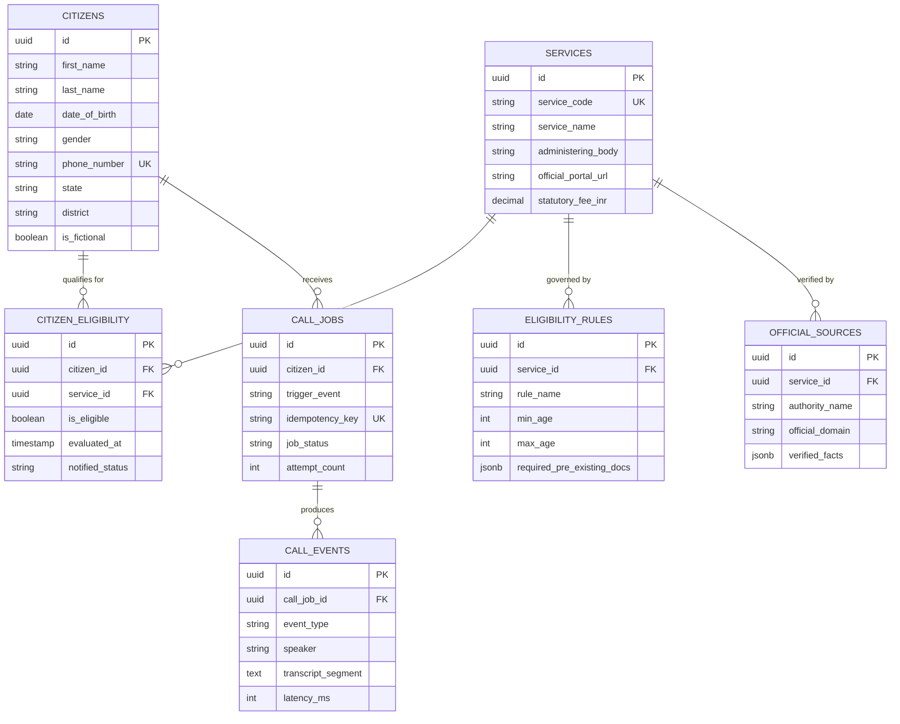
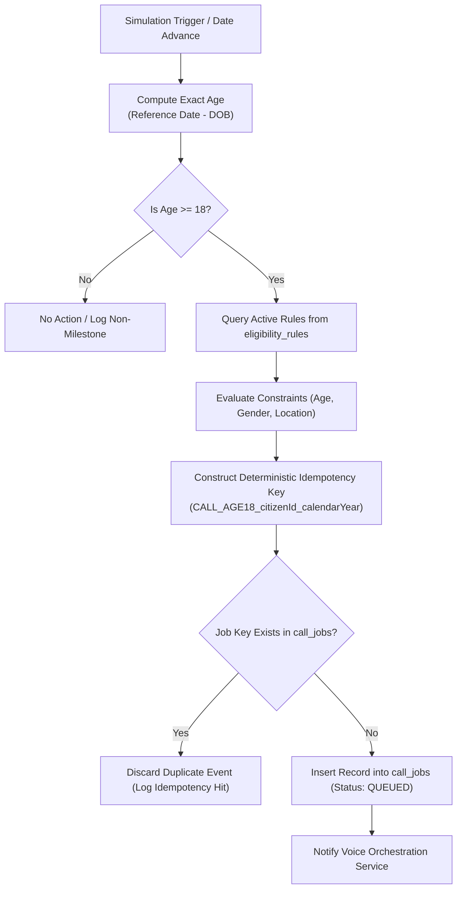
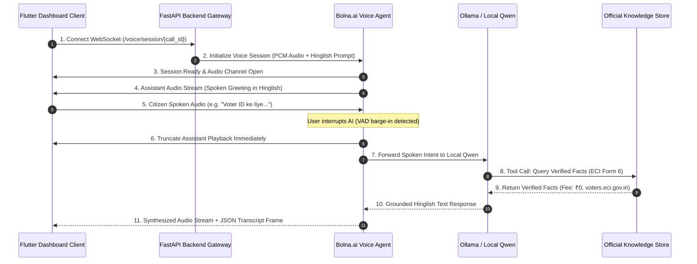

# Timbre — Technical Architecture & Implementation Guide (TECH.md)

> **Single Source of Truth for Technical Architecture, Data Schemas, APIs, and Engineering Specifications**  
> *Timbre is the project name; Bharat Assist is the product concept behind Timbre.*

[](#b-system-architecture--two-machine-engineering)
[-009688.svg)](#a-technology-stack)
[-02569B.svg)](#a-technology-stack)
[-412991.svg)](#g-real-time-voice-architecture)
[](README.md)
[](FRONTEND.md)

---

## Table of Contents

1. [A. Technology Stack](#a-technology-stack)
2. [B. System Architecture & Two-Machine Engineering](#b-system-architecture--two-machine-engineering)
3. [C. Repository Structure](#c-repository-structure)
4. [D. Database Design](#d-database-design)
5. [E. Backend API Specification (Proposed Contract)](#e-backend-api-specification-proposed-contract)
6. [F. Event-Driven Eligibility Engine](#f-event-driven-eligibility-engine)
7. [G. Real-Time Voice Architecture](#g-real-time-voice-architecture)
8. [H. Government Knowledge Retrieval](#h-government-knowledge-retrieval)
9. [I. API Testing and Observability](#i-api-testing-and-observability)
10. [J. Environment and Security](#j-environment-and-security)
11. [K. Setup and Development](#k-setup-and-development)
12. [L. Testing Strategy](#l-testing-strategy)
13. [M. Scaling and Deployment](#m-scaling-and-deployment)

---

## A. Technology Stack

The technology stack is designed to achieve low-latency audio streaming, strict rule-driven evaluation, and responsive cross-platform administration.

| Technology | Purpose & Architectural Role | Integration Boundaries | Implementation Status |
| :--- | :--- | :--- | :---: |
| **Flutter 3.19+ & Dart 3.3+** | Cross-platform administration dashboard and simulation cockpit for macOS Desktop and Chrome. | Communicates with FastAPI via REST endpoints and connects to WebSockets for live call monitoring. Runs offline with local demo provider. | **Implemented (Milestone 1 on MacBook)** |
| **Python 3.11+ & FastAPI** | Core backend orchestrator, REST API gateway, WebSocket audio proxy, and eligibility rule calculation engine. | Interfaces with PostgreSQL/Supabase, bridges audio to Voice AI, and serves REST endpoints. | **In Progress (ASUS AGY)** |
| **Local Qwen via Ollama** | Open-source local large language model for natural Hinglish dialog turn generation and topic switching. | Hosted locally on ASUS TUF GPU; invoked by Bolna.ai and FastAPI. | **In Progress (ASUS AGY)** |
| **Bolna.ai Voice Agent** | Real-time speech-to-speech conversational orchestrator supporting voice activity detection (barge-in) and audio streaming. | Interfaces between citizen audio channels and the local LLM. | **In Progress (ASUS AGY)** |
| **Supabase & PostgreSQL 15+** | Relational persistence, JSONB rule evaluation, transactional state management, and real-time event streaming. | Accessible by backend service role; enforces row-level security and schema constraints. | **Planned (ASUS AGY)** |
| **Official Government Sources** | Curated catalog of verified statutory facts, official portal URLs, fee tables, and required application documents. | Read-only structured knowledge store referenced by the rule engine and injected into conversational context. | **Implemented (Catalog)** |
| **FastAPI Swagger UI & OpenAPI** | Interactive API testing, schema introspection, and automated client generation via `/docs`. | Built into FastAPI framework; allows testing endpoints without external tooling. | **Planned (ASUS AGY)** |
| **Authorized CPaaS Telephony** *(Future)* | Telephony carrier integration (e.g., Exotel, Twilio India) for actual PSTN cellular calling. | Restricted to future exploratory phases subject to TRAI/DoT compliance and citizen consent. | **Future Exploratory** |

---

## B. System Architecture & Two-Machine Engineering

Timbre’s engineering workflow divides responsibilities across two development nodes, coordinated by Codex:

```mermaid
flowchart TD
    subgraph MacBook["MacBook Air M5 (Frontend Owner)"]
        UI_Dash["Admin Management Dashboard (Flutter)"]
        UI_Sim["Life-Event Simulation Cockpit"]
        UI_Monitor["Call Queue & Transcript Inspector"]
        Mock_Repo["Isolated Demo Provider (Offline)"]
        REST_Client["Configurable REST / WS API Client"]
        
        UI_Dash --> UI_Sim
        UI_Dash --> UI_Monitor
        UI_Dash <--> Mock_Repo
        UI_Dash <--> REST_Client
    end

    subgraph Codex["Codex (Architecture & Coordination)"]
        Contract["Shared API Contracts & Schemas"]
        Review["Code Reviews & Conflict Resolution"]
        Integration["End-to-End Test Validation"]
        Merge["Controlled Merges to Main"]
    end

    subgraph ASUS["ASUS TUF (Backend Owner)"]
        API_Gateway["FastAPI Gateway (/api/v1)"]
        EventWorker["Age Milestone Detection Worker"]
        RuleEngine["Eligibility Rule Engine"]
        CallQueue["Deduplicated Call Job Manager"]
        VoiceOrchestrator["Bolna.ai + Ollama (Qwen) Bridge"]
        DB[("PostgreSQL / Supabase Database")]
        
        API_Gateway --> EventWorker
        EventWorker --> RuleEngine
        RuleEngine --> CallQueue
        CallQueue --> VoiceOrchestrator
        RuleEngine <--> DB
        CallQueue <--> DB
    end

    REST_Client -.->|HTTP / WS (Configurable IP:Port)| API_Gateway
    Codex -.->|Audits & Validates| MacBook
    Codex -.->|Audits & Validates| ASUS
```

### Responsibility Breakdown
1. **MacBook AGY (MacBook Air M5)**:
   - Scaffolds and maintains the Flutter application (`frontend/`).
   - Implements UI, responsive navigation, and accessible Material 3 styling.
   - Manages client-side state reactively with explicit loading, empty, success, and error states.
   - Provides an isolated in-memory demo data provider for offline evaluation without requiring the ASUS backend.
   - Implements configurable HTTP REST and WebSocket client layers with error recovery.
   - Maintains frontend automated unit and widget test suites.
2. **ASUS AGY (ASUS TUF Laptop)**:
   - Implements Python 3.11+ and FastAPI services.
   - Manages relational database persistence, migrations, and synthetic seed datasets.
   - Implements the server-side citizen event detector and eligibility engine.
   - Manages local LLM inference via Ollama (Qwen) and Bolna.ai voice streaming.
   - Implements backend unit and integration tests.
3. **Codex**:
   - Maintains system-wide architectural integrity and shared API contracts.
   - Coordinates task handoffs and resolves schema discrepancies.
   - Conducts rigorous code reviews and controls branch merges into `main`.

---

## C. Repository Structure

### Current Repository Layout (Verified on `macbook-agy`)

```
/Users/sidh._./Timbre/
├── .gitignore                          # Git exclusions for OS, IDE, Python, & Flutter artifacts
├── README.md                           # Main product overview & status
├── TECH.md                             # Technical architecture & engineering guide (this file)
├── FRONTEND.md                         # Detailed frontend implementation guide & specifications
│
└── frontend/                           # Flutter 3.19+ Administrative Dashboard Application
    ├── pubspec.yaml                    # Flutter dependencies (http, cupertino_icons)
    ├── analysis_options.yaml           # Strict Dart linter rules
    ├── test/
    │   ├── widget_test.dart            # Smoke & navigation widget test
    │   └── unit/
    │       ├── citizen_test.dart       # Age computation, leap year, & model serialization tests
    │       ├── mock_repository_test.dart# Lifecycle, simulation, & idempotency key tests
    │       └── app_state_test.dart     # Reactive state management tests
    └── lib/
        ├── main.dart                   # Application entrypoint & initialization
        ├── core/
        │   ├── config/
        │   │   └── app_config.dart     # Configurable backend host URL, timeouts, & mode
        │   └── theme/
        │       └── app_theme.dart      # Material 3 administrative theme
        ├── models/
        │   ├── citizen.dart            # Fictional citizen profile with is_fictional guard
        │   ├── service_scheme.dart     # Government scheme model (Voter ID, Licence, PMJAY)
        │   ├── eligibility_result.dart # Evaluation outcome & qualification reason
        │   ├── call_job.dart           # Idempotent call queue model
        │   └── call_event.dart         # Spoken transcript turn & telemetry marker
        ├── services/
        │   ├── backend_health.dart     # Connection health status model
        │   ├── citizen_repository.dart # Abstract repository interface
        │   ├── mock_citizen_repository.dart # Offline synthetic data provider & rule simulator
        │   └── api_citizen_repository.dart  # Real REST client for ASUS FastAPI
        ├── state/
        │   └── app_state.dart          # Observable ChangeNotifier application state
        ├── widgets/
        │   ├── backend_health_pill.dart# Interactive status pill & URL configuration modal
        │   └── fictional_banner.dart   # Prominent prototype safety invariant banner
        └── screens/
            ├── shell/
            │   └── app_shell.dart      # Master responsive NavigationRail scaffold
            ├── dashboard/
            │   └── dashboard_screen.dart # Administrative KPIs, metrics, & quick triggers
            ├── citizens/
            │   └── citizens_screen.dart# Searchable citizen registry & detail inspection
            ├── simulation/
            │   └── simulation_screen.dart # Milestone age 18 life-event simulator
            ├── eligibility/
            │   └── eligibility_screen.dart # Statutory scheme qualification engine
            ├── calls/
            │   └── call_monitor_screen.dart # Call queue & Hinglish transcript viewer
            └── services/
                └── services_screen.dart# Government knowledge catalog & portal directory
```

---

## D. Database Design

The relational schema is structured around data minimization, strict deduplication, auditability, and safety flags for fictional data.

### Entity Relationship Model



### Table Definitions (SQL DDL)

#### 1. `citizens`
Stores synthetic citizen profiles. The `is_fictional` column acts as an immutable safety invariant.

```sql
CREATE TABLE citizens (
    id UUID PRIMARY KEY DEFAULT gen_random_uuid(),
    first_name VARCHAR(100) NOT NULL,
    last_name VARCHAR(100) NOT NULL,
    date_of_birth DATE NOT NULL,
    gender VARCHAR(20) NOT NULL,
    phone_number VARCHAR(15) NOT NULL UNIQUE,       -- Fictional MSISDN (e.g., +91 99999 XXXXX)
    state VARCHAR(50) NOT NULL,
    district VARCHAR(50) NOT NULL,
    pincode VARCHAR(10) NOT NULL,
    simulated_income_bracket VARCHAR(30),
    is_fictional BOOLEAN DEFAULT TRUE NOT NULL,      -- Hard safety flag
    created_at TIMESTAMPTZ DEFAULT NOW(),
    updated_at TIMESTAMPTZ DEFAULT NOW()
);
```

#### 2. `services`
Stores public welfare schemes, statutory documents, and administering authorities.

```sql
CREATE TABLE services (
    id UUID PRIMARY KEY DEFAULT gen_random_uuid(),
    service_code VARCHAR(50) UNIQUE NOT NULL,       -- e.g., 'VOTER_ID_ECI', 'LEARNERS_LICENCE_MORTH'
    service_name VARCHAR(150) NOT NULL,
    administering_body VARCHAR(150) NOT NULL,       -- e.g., 'Election Commission of India'
    official_portal_url TEXT NOT NULL,
    statutory_fee_inr NUMERIC(8, 2) DEFAULT 0.00,
    application_mode VARCHAR(30) NOT NULL,          -- 'ONLINE', 'HYBRID', 'OFFLINE'
    description_english TEXT NOT NULL,
    description_hinglish TEXT NOT NULL,
    is_active BOOLEAN DEFAULT TRUE NOT NULL,
    created_at TIMESTAMPTZ DEFAULT NOW()
);
```

#### 3. `eligibility_rules`
Defines programmatic constraints evaluated by the backend rule engine.

```sql
CREATE TABLE eligibility_rules (
    id UUID PRIMARY KEY DEFAULT gen_random_uuid(),
    service_id UUID REFERENCES services(id) ON DELETE CASCADE,
    rule_name VARCHAR(100) NOT NULL,
    min_age INT,
    max_age INT,
    gender_filter VARCHAR(20),                      -- NULL = applicable to all genders
    state_filter VARCHAR(50),                       -- NULL = nationwide
    required_pre_existing_docs JSONB DEFAULT '[]',  -- e.g., ["Aadhaar", "Address Proof"]
    rule_logic_expression JSONB,                    -- Extensible JSON logic conditions
    created_at TIMESTAMPTZ DEFAULT NOW()
);
```

#### 4. `citizen_eligibility`
Maintains the evaluated eligibility status for each citizen-service pair.

```sql
CREATE TABLE citizen_eligibility (
    id UUID PRIMARY KEY DEFAULT gen_random_uuid(),
    citizen_id UUID REFERENCES citizens(id) ON DELETE CASCADE,
    service_id UUID REFERENCES services(id) ON DELETE CASCADE,
    is_eligible BOOLEAN NOT NULL DEFAULT FALSE,
    evaluated_at TIMESTAMPTZ DEFAULT NOW(),
    qualification_reason TEXT,
    notified_status VARCHAR(30) DEFAULT 'PENDING',  -- 'PENDING', 'QUEUED', 'NOTIFIED', 'DISMISSED'
    UNIQUE(citizen_id, service_id)
);
```

#### 5. `call_jobs`
Deduplicated outbound call job queue enforcing idempotency.

```sql
CREATE TABLE call_jobs (
    id UUID PRIMARY KEY DEFAULT gen_random_uuid(),
    citizen_id UUID REFERENCES citizens(id) ON DELETE CASCADE,
    trigger_event VARCHAR(50) NOT NULL,             -- e.g., 'MILESTONE_AGE_18'
    job_status VARCHAR(30) DEFAULT 'QUEUED',        -- 'QUEUED', 'IN_PROGRESS', 'COMPLETED', 'FAILED', 'RETRY_SCHEDULED'
    idempotency_key VARCHAR(120) UNIQUE NOT NULL,   -- e.g., 'CALL_AGE18_<citizen_id>_2026'
    attempt_count INT DEFAULT 0,
    max_retries INT DEFAULT 2,
    scheduled_at TIMESTAMPTZ DEFAULT NOW(),
    initiated_at TIMESTAMPTZ,
    completed_at TIMESTAMPTZ,
    created_at TIMESTAMPTZ DEFAULT NOW()
);
```

#### 6. `call_events`
Stores granular conversation turns, audio telemetry, and topic-shift logs.

```sql
CREATE TABLE call_events (
    id UUID PRIMARY KEY DEFAULT gen_random_uuid(),
    call_job_id UUID REFERENCES call_jobs(id) ON DELETE CASCADE,
    event_type VARCHAR(50) NOT NULL,                -- 'CONNECTED', 'BARGE_IN', 'TOPIC_SWITCH', 'COMPLETED'
    speaker VARCHAR(20),                            -- 'AI_AGENT', 'CITIZEN', 'SYSTEM'
    transcript_segment TEXT,
    sentiment_detected VARCHAR(30),
    referenced_service_id UUID REFERENCES services(id),
    latency_ms INT,
    created_at TIMESTAMPTZ DEFAULT NOW()
);
```

#### 7. `official_sources`
Catalog of verified government repositories and truth records.

```sql
CREATE TABLE official_sources (
    id UUID PRIMARY KEY DEFAULT gen_random_uuid(),
    service_id UUID REFERENCES services(id) ON DELETE CASCADE,
    authority_name VARCHAR(150) NOT NULL,
    official_domain VARCHAR(150) NOT NULL,          -- e.g., 'voters.eci.gov.in'
    last_verified_date DATE NOT NULL,
    verification_agent VARCHAR(100) NOT NULL,
    verified_facts JSONB NOT NULL                   -- Ground truth checklist of forms, fees, steps
);
```

---

## E. Backend API Specification (Proposed Contract)

> [!NOTE]
> All endpoints below represent the planned specification for the upcoming FastAPI implementation on the ASUS TUF laptop. Currently, endpoints are proposed contracts until confirmed by Codex.

### Endpoint Matrix

| Method | Route | Description | Auth Scope | Status |
| :--- | :--- | :--- | :--- | :---: |
| `GET` | `/health` | Backend connection health check & latency check. | Public | Proposed |
| `GET` | `/citizens` | Paginated listing of synthetic citizen profiles. | `admin:read` | Proposed |
| `PATCH` | `/citizens/{citizen_id}` | Update citizen profile fields (e.g., date of birth). | `admin:write` | Proposed |
| `POST` | `/citizens/{citizen_id}/evaluate` | Recalculate scheme eligibility for a given citizen. | `engine:execute` | Proposed |
| `POST` | `/demo/calls` | Manually or programmatically trigger a simulated call job. | `demo:write` | Proposed |
| `GET` | `/demo/calls/{call_id}` | Retrieve call status, duration, transcripts, and telemetry. | `demo:read` | Proposed |
| `WS` | `/voice/session/{call_id}` | WebSocket stream bridging in-app client audio to Voice AI. | `voice:stream` | Proposed |

---

### Detailed Endpoint Specifications

#### 1. `GET /citizens`
Retrieves a paginated list of synthetic citizens for administration and simulation testing.

- **Query Parameters**:
  - `limit` (integer, default: 20, max: 100)
  - `offset` (integer, default: 0)
  - `age` (integer, optional filter)
  - `state` (string, optional filter)
- **Response (`200 OK`)**:
```json
{
  "total": 100,
  "limit": 20,
  "offset": 0,
  "citizens": [
    {
      "id": "e4b3c2a1-8765-4321-ba98-76543210feaa",
      "first_name": "Aarav",
      "last_name": "Sharma",
      "date_of_birth": "2008-10-21",
      "age": 18,
      "gender": "MALE",
      "phone_number": "+91-99999-00012",
      "state": "Uttar Pradesh",
      "district": "Lucknow",
      "is_fictional": true
    }
  ]
}
```

#### 2. `PATCH /citizens/{citizen_id}`
Updates a citizen's profile. Used during simulations to alter a citizen's date of birth and trigger age milestones.

- **Path Parameter**: `citizen_id` (UUID)
- **Request Body**:
```json
{
  "date_of_birth": "2008-10-21"
}
```
- **Validation**:
  - `date_of_birth` must be a valid ISO 8601 date not in the future.
  - Rejects attempts to alter `is_fictional` (immutable `true`).
- **Response (`200 OK`)**:
```json
{
  "citizen_id": "e4b3c2a1-8765-4321-ba98-76543210feaa",
  "previous_dob": "2008-11-25",
  "updated_dob": "2008-10-21",
  "calculated_age": 18,
  "event_detected": "MILESTONE_AGE_18"
}
```

#### 3. `POST /citizens/{citizen_id}/evaluate`
Triggers an immediate evaluation of all active statutory services for a specific citizen.

- **Path Parameter**: `citizen_id` (UUID)
- **Request Body**: Empty or `{ "force_recheck": true }`
- **Response (`200 OK`)**:
```json
{
  "citizen_id": "e4b3c2a1-8765-4321-ba98-76543210feaa",
  "evaluated_at": "2026-10-21T09:30:00Z",
  "eligible_services": [
    {
      "service_code": "VOTER_ID_ECI",
      "service_name": "Voter Registration (Form 6)",
      "authority": "Election Commission of India",
      "official_portal_url": "https://voters.eci.gov.in/"
    },
    {
      "service_code": "LEARNERS_LICENCE_MORTH",
      "service_name": "Learner's Driving Licence",
      "authority": "Ministry of Road Transport and Highways",
      "official_portal_url": "https://parivahan.gov.in/"
    }
  ],
  "call_job_scheduled": true,
  "call_job_id": "98a7b6c5-1234-5678-90ab-cdef12345678"
}
```

#### 4. `POST /demo/calls`
Creates a deduplicated simulated call job for a qualifying citizen.

- **Request Body**:
```json
{
  "citizen_id": "e4b3c2a1-8765-4321-ba98-76543210feaa",
  "trigger_event": "MILESTONE_AGE_18"
}
```
- **Error Responses**:
  - `409 Conflict`: If an active or completed call job already exists with the same idempotency key.
- **Response (`201 Created`)**:
```json
{
  "job_id": "98a7b6c5-1234-5678-90ab-cdef12345678",
  "citizen_id": "e4b3c2a1-8765-4321-ba98-76543210feaa",
  "idempotency_key": "CALL_AGE18_e4b3c2a1-8765-4321-ba98-76543210feaa_2026",
  "status": "QUEUED",
  "scheduled_at": "2026-10-21T09:30:05Z"
}
```

#### 5. `GET /demo/calls/{call_id}`
Retrieves the execution status, spoken transcripts, and telemetry for a simulated call job.

- **Path Parameter**: `call_id` (UUID)
- **Response (`200 OK`)**:
```json
{
  "job_id": "98a7b6c5-1234-5678-90ab-cdef12345678",
  "status": "COMPLETED",
  "attempt_count": 1,
  "duration_seconds": 138,
  "barge_in_count": 1,
  "topic_switches": 1,
  "events": [
    {
      "timestamp": "2026-10-21T09:30:10Z",
      "speaker": "AI_AGENT",
      "transcript_segment": "Namaste Aarav ji! Main Timbre se bol raha hoon..."
    },
    {
      "timestamp": "2026-10-21T09:30:20Z",
      "speaker": "CITIZEN",
      "transcript_segment": "Haan ji namaste. Kaunse dastavej?"
    }
  ]
}
```

---

## F. Event-Driven Eligibility Engine

The eligibility engine evaluates whether a synthetic citizen qualifies for public welfare schemes or civic documentation.



### 1. Age Calculation Algorithm
To avoid leap-year boundary errors, age is computed strictly using date math rather than naive day divisions (e.g., dividing by 365):
```dart
static int calculateAge(DateTime dob, [DateTime? referenceDate]) {
  final ref = referenceDate ?? DateTime.now();
  int age = ref.year - dob.year;
  if (ref.month < dob.month || (ref.month == dob.month && ref.day < dob.day)) {
    age--;
  }
  return age;
}
```

### 2. Idempotency Key Design & Duplicate Prevention
To ensure citizens are never spammed with repeated calls for the same milestone:
- **Format**: `CALL_<EVENT_TYPE>_<CITIZEN_ID>_<TEMPORAL_WINDOW>`
- **Example**: `CALL_AGE18_e4b3c2a1-8765-4321-ba98-76543210feaa_2026`
- **Database Enforcement**: `call_jobs.idempotency_key` carries a `UNIQUE` constraint. Attempted re-insertions are caught at the database level (`ON CONFLICT DO NOTHING`).

---

## G. Real-Time Voice Architecture

The planned voice pipeline combines Bolna.ai and local Qwen inference hosted on the ASUS TUF laptop:



### Key Conversational Voice Parameters
1. **Audio Encoding & Transport**: Full-duplex PCM 16-bit, 24kHz, mono audio streamed over WebSockets.
2. **Server-Side Voice Activity Detection (VAD)**: Configured with low speech-detection thresholds (~300ms) to support sub-second barge-in when the caller interrupts the AI.
3. **Vernacular Hinglish Persona**: System instructions guide the model to use natural Hindi syntax interlaced with everyday English terms, respectful Indian honorifics (*"Ji"*), and clear phonetic enunciation of official URLs.
4. **Tool Calling for Fact Retrieval**: When specific service queries are detected, the model triggers structured tool calls against the backend knowledge base rather than relying on ungrounded model weights.
5. **In-App Simulation vs. Future Telephony**: The prototype terminates audio within the Flutter dashboard / browser client via WebRTC/AudioContext. Future PSTN telephony integration (via SIP trunks or CPaaS providers) will reuse the same orchestrator protocol.

---

## H. Government Knowledge Retrieval

To protect citizens from misinformation, hallucinated deadlines, or fraudulent third-party payment links, Timbre enforces strict knowledge grounding.

### Curated Knowledge Base Schema
Verified public service records are cataloged in `official_sources` with the following structure:

```json
{
  "service_code": "VOTER_ID_ECI",
  "authority": "Election Commission of India",
  "portal_url": "https://voters.eci.gov.in/",
  "statutory_fee_inr": 0.00,
  "eligible_age": 18,
  "statutory_form": "Form 6 (Application for Inclusion of Name in Electoral Roll)",
  "required_documents": [
    "Recent passport-size colour photograph",
    "Proof of Age (Birth Certificate / Aadhaar / PAN / 10th Marksheet)",
    "Proof of Ordinary Residence (Electricity / Water Bill / Passbook / Ration Card)"
  ],
  "verification_agent": "ECI_GAZETTE_2026",
  "last_verified_date": "2026-10-01"
}
```

### Official Reference Authorities
- **Election Commission of India (ECI)**: [voters.eci.gov.in](https://voters.eci.gov.in/) & [eci.gov.in](https://eci.gov.in/)
- **Ministry of Road Transport and Highways (MoRTH - Parivahan)**: [parivahan.gov.in](https://parivahan.gov.in/)
- **Unique Identification Authority of India (UIDAI)**: [uidai.gov.in](https://uidai.gov.in/)
- **Income Tax Department (PAN Services)**: [incometax.gov.in](https://www.incometax.gov.in/)
- **Open Government Data (OGD) Platform India**: [data.gov.in](https://data.gov.in/)
- **National Portal of India**: [india.gov.in](https://www.india.gov.in/)

---

## I. API Testing and Observability

### 1. Interactive Swagger UI & OpenAPI
FastAPI automatically generates comprehensive interactive documentation at `/docs` (Swagger UI) and `/redoc` (ReDoc) based on Pydantic schemas. Developers can test endpoints, inspect payload definitions, and validate responses without external tools.

### 2. Structured JSON Logging & Audit Trails
Every inbound request, eligibility evaluation, and voice session event generates a structured JSON log entry containing:
- `timestamp`: UTC ISO 8601 string.
- `trace_id`: Unique correlation UUID per request/session.
- `citizen_id`: Target synthetic citizen ID.
- `event_type`: Categorical identifier (`BARGE_IN`, `TOPIC_SWITCH`, `TOOL_QUERY`).
- `latency_ms`: Round-trip response time in milliseconds.

### 3. Failure & Retry Logging
Failed call jobs (e.g., simulated client disconnection) trigger a state transition to `RETRY_SCHEDULED`. The dispatcher enforces exponential back-off (e.g., 15m, 60m) before marking the job `FAILED_EXHAUSTED`. All failure reasons are recorded in `call_jobs.error_message`.

---

## J. Environment and Security

### Configuration Variables
| Variable | Default | Purpose |
| :--- | :--- | :--- |
| `BACKEND_URL` | `http://localhost:8000/api/v1` | Base REST endpoint for FastAPI services. |
| `IS_DEMO_MODE` | `true` | When true, forces isolated local demo provider. |
| `REQUEST_TIMEOUT` | `5s` | Network timeout for backend REST requests. |

> [!CAUTION]
> **Secret Management**: Never commit credentials, private keys, or actual telephone numbers to version control. Production secrets must be managed through secure environment variables.

### Data Protection & Synthetic Isolation
- All citizen profiles feature `is_fictional = true`.
- Backend endpoints reject any payload containing real Indian Aadhaar numbers (12-digit Verhoeff format) or valid personal identifiers.
- In-memory audio buffers are discarded immediately following transcript extraction.

---

## K. Setup and Development

### 1. Frontend Setup (MacBook Air M5)
```bash
# Navigate to frontend directory
cd frontend

# Verify dependencies
flutter pub get

# Run formatting check
dart format --output=none --set-exit-if-changed lib test

# Run static analysis
flutter analyze

# Execute automated unit and widget test suite
flutter test

# Run locally on macOS Desktop
flutter run -d macos

# Run locally in Google Chrome
flutter run -d chrome
```

### 2. Backend Setup (ASUS TUF Laptop - Planned / In Progress)
```bash
cd backend
python3 -m venv venv
source venv/bin/activate
pip install -r requirements.txt
uvicorn app.main:app --host 0.0.0.0 --port 8000 --reload
```

---

## L. Testing Strategy

The testing strategy validates system behavior across boundary edge cases, idempotency guarantees, and UI rendering:

### Automated Frontend Test Suite (11/11 Passing)

```
00:00 +0: Citizen Model Tests calculateAge computes exact age correctly
00:00 +1: Citizen Model Tests toJson and fromJson maintain data integrity
00:00 +2: Citizen Model Tests copyWith updates specified fields correctly
00:00 +3: MockCitizenRepository Lifecycle & Simulation Tests getCitizens returns synthetic records with fictional flag
00:00 +4: MockCitizenRepository Lifecycle & Simulation Tests getCitizens search filter matches name or state
00:00 +5: MockCitizenRepository Lifecycle & Simulation Tests Simulating DOB change to age 18 detects MILESTONE_AGE_18 and creates call job
00:00 +6: MockCitizenRepository Lifecycle & Simulation Tests evaluateEligibility qualifies 18-year-old for Voter ID and Learner Licence
00:00 +7: AppState Tests init loads citizens, call jobs, and services
00:00 +8: AppState Tests selectCitizen updates selected citizen and loads eligibility
00:00 +9: AppState Tests simulateDobChange triggers reactive state updates
00:00 +10: TimbreApp dashboard renders with safety banner and navigation
00:00 +11: All tests passed!
```

---

## M. Scaling and Deployment

- **Concurrency Controls**: Concurrency caps on concurrent outbound simulations.
- **Telecom Regulatory Safeguards**: In accordance with TRAI/TCCCPR rules, actual dialing requires DLT principal registration, DND scrubbing, and daytime calling windows (09:00 to 21:00 IST). Prototype operates strictly in simulation mode.

---

*For product overview, citizen use cases, and feature descriptions, refer to [README.md](README.md).*
