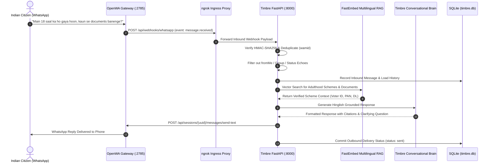

# 🇮🇳 TIMBRE — The Voice & Civic Intelligence Platform for Bharat

> **Empowering 1.4 Billion Citizens with Natural-Language Civic Entitlements, Identity Discovery, and Proactive AI Guidance.**

[](#)
[](#)
[](#)
[](#)
[-brightgreen.svg)](#)

---

## 📑 Table of Contents

1. [Executive Summary](#1-executive-summary)
2. [The Core Problem: What 1.4 Billion Indians Face Daily](#2-the-core-problem-what-14-billion-indians-face-daily)
   - [The Digital Literacy Paradox](#21-the-digital-literacy-paradox)
   - [The Linguistic & Bureaucratic Chasm](#22-the-linguistic--bureaucratic-chasm)
   - [The Information Discovery Deficit](#23-the-information-discovery-deficit)
   - [The Middlemen ("Dalal") & Cyber-Café Tax](#24-the-middlemen-dalal--cyber-caf%C3%A9-tax)
   - [The Document Confusion Maze](#25-the-document-confusion-maze)
3. [What Timbre Solves Today (The Working MVP)](#3-what-timbre-solves-today-the-working-mvp)
   - [Accessible Where Citizens Live: WhatsApp](#31-accessible-where-citizens-live-whatsapp)
   - [Conversational Understanding in Hinglish & Hindi](#32-conversational-understanding-in-hinglish--hindi)
   - [Zero Hallucination Statutory Grounding (FastEmbed RAG)](#33-zero-hallucination-statutory-grounding-fastembed-rag)
   - [Proactive Milestone Intelligence (e.g., Turning 18)](#34-proactive-milestone-intelligence-eg-turning-18)
   - [Aadhaar & PII Protection Shield](#35-aadhaar--pii-protection-shield)
   - [Direct Official Government Portal Routing](#36-direct-official-government-portal-routing)
4. [System Architecture & Flow](#4-system-architecture--flow)
5. [Future Goal: The AI Inbound & Outbound Voice Calling Agent](#5-future-goal-the-ai-inbound--outbound-voice-calling-agent)
   - [Why Voice Calls Are Essential for Rural Bharat](#51-why-voice-calls-are-essential-for-rural-bharat)
   - [Inbound Voice Agent: Dial In from Any Phone](#52-inbound-voice-agent-dial-in-from-any-phone)
   - [Outbound Milestone Proactive Calls: Timbre Calls You](#53-outbound-milestone-proactive-calls-timbre-calls-you)
   - [Voice Architecture & Real-Time Telephony Mechanics](#54-voice-architecture--real-time-telephony-mechanics)
   - [Handling Indian Accents, Dialects, and Cellular Noise](#55-handling-indian-accents-dialects-and-cellular-noise)
6. [Supported Statutory Schemes Catalogue](#6-supported-statutory-schemes-catalogue)
7. [Technology Stack & Implementation Integrity](#7-technology-stack--implementation-integrity)
8. [Thank You & Acknowledgements](#8-thank-you--acknowledgements)

---

## 1. Executive Summary

India has created the world’s most advanced digital public infrastructure—from **Aadhaar** and **DigiLocker** to **UPI**, **CoWIN**, and statutory online registries like the **National Voter's Service Portal (NVSP)** and **Parivahan Sewa**. 

Yet, for hundreds of millions of everyday citizens—smallholder farmers in Uttar Pradesh, daily-wage workers in Bihar, first-generation college students in Madhya Pradesh, or elderly pensioners in Maharashtra—this digital revolution remains locked behind complex web forms, English-dominant portals, CAPTCHAs, OTP timeouts, and bureaucratic vocabulary.

**TIMBRE** is an AI-powered civic intelligence companion designed to bridge this last mile. 

Rather than expecting citizens to decipher administrative gazettes or navigate multi-tier websites, Timbre meets them where they already communicate:
1. **Today (MVP):** Through natural, conversational **WhatsApp text messaging** in Hindi, Hinglish, or English.
2. **Tomorrow (Roadmap):** Through **two-way AI phone calls**, allowing citizens with basic feature phones or smartphones to dial a standard phone number, speak naturally, and receive instant, grounded guidance about what documents they qualify for, what papers they need, and how to apply officially.

Timbre does not replace government portals; it serves as a **trusted digital navigator**, ensuring that no Indian citizen misses a constitutional right, civic milestone, or welfare entitlement due to a lack of awareness or literacy.

---

## 2. The Core Problem: What 1.4 Billion Indians Face Daily

```
┌────────────────────────────────────────────────────────────────────────┐
│                   THE INDIAN CITIZEN'S CIVIC REALITY                   │
└────────────────────────────────────────────────────────────────────────┘
          │
          ├── 1. The Digital Literacy Paradox (Owns phone, but can't use complex portals)
          ├── 2. The Linguistic Chasm (Spoken Hinglish vs Archaic Administrative English)
          ├── 3. The Discovery Deficit (Only learn about schemes after deadlines expire)
          ├── 4. The Dalal / Cyber-Café Tax (Overpaying ₹500–₹2,000 for free government services)
          └── 5. The Document Confusion Maze (Which ID serves as age proof vs address proof?)
```

### 2.1 The Digital Literacy Paradox
Over 750 million Indians own smartphones and use messaging apps like WhatsApp every single day to send voice notes, photos, and messages. However, **using a messaging app does not equal digital bureaucratic fluency**. 

When faced with official government portals, citizens are confronted with:
- Nested dropdowns with state-specific administrative jurisdictions (Tehsil, Taluka, Block, Ward).
- Strict photo and document compression limits (e.g., *"Upload PDF under 200 KB"*).
- Fragile OTP sessions that expire before poor rural cellular networks deliver the SMS.
- Cryptic CAPTCHA images that fail repeatedly on mobile browser viewports.

As a result, millions of citizens give up before completing their applications.

### 2.2 The Linguistic & Bureaucratic Chasm
More than 90% of Indian daily dialogue takes place in regional languages or colloquial, code-switched dialects such as **Hinglish** (Hindi mixed with familiar English loanwords like *form*, *date of birth*, *licence*, *portal*, *scheme*, and *marksheet*).

In sharp contrast, government circulars, legal gazettes, and official application portals are written in:
- High-register, formal bureaucratic English; or
- Formal, Sanskritized Hindi that rarely matches the everyday spoken vernacular of the common citizen.

When an 18-year-old says, *"Main 18 saal ka ho gaya hoon, mujhe kaun se documents banwane chahiye?"*, no standard government portal search bar understands the colloquial intent.

### 2.3 The Information Discovery Deficit
In India, **entitlements are passive**. The government announces welfare schemes, but citizens must independently discover that they qualify:
- A teenager turns 18 and doesn't know they must submit **Form 6** on `voters.eci.gov.in` months before an election to vote.
- A smallholder farmer does not know that linking land records to Aadhaar unlocks the **₹6,000 annual PM-KISAN** transfer.
- An underprivileged first-generation college student misses the **National Scholarship Portal (NSP)** window because the notice was published on a departmental bulletin board they never saw.
- A senior citizen turning 60 remains unaware of the **Indira Gandhi National Old Age Pension Scheme (IGNOAPS)**.

### 2.4 The Middlemen ("Dalal") & Cyber-Café Tax
Because official portals are perceived as intimidating and opaque, an entire informal economy of touts, unaccredited cyber-café operators, and middlemen (*dalals*) flourishes outside district collectorates and transport offices:
- Charging **₹500 to ₹2,000** for a Voter ID card or PAN card (which is legally free or costs ~₹50 on official portals).
- Exploiting citizens by demanding personal documents, retaining copies of Aadhaar cards, and charging recurring "service fees" for checking basic application statuses.

### 2.5 The Document Confusion Maze
Citizens frequently have their applications rejected because they misunderstand statutory documentation rules:
- Submitting an Aadhaar card for date of birth proof when the issuing department requires a birth certificate or 10th marksheet.
- Not knowing which documents count as valid Address Proof versus Identity Proof.
- Submitting un-attested copies or wrong application form numbers (e.g., Form 6 for new voters vs Form 8 for address updates).

---

## 3. What Timbre Solves Today (The Working MVP)

Timbre transforms this broken experience into a **simple, dignified, 1-on-1 conversation**.

```
Citizen WhatsApp Message:
"Namaste! Main 18 saal ka ho gaya hoon, mujhe kaun se documents banwane chahiye?"
                                    │
                                    ▼
Timbre AI Assistant Reply:
"Namaste Rohan ji! Main Timbre hoon, ek AI civic assistant. 
18 saal ka hone par हार्दिक बधाई! 18 saal ki umra mein aap ye mukhya 
government documents banwa sakte hain:

1. Voter ID (Form 6): Vote daalne ke liye official ECI portal (voters.eci.gov.in) par.
2. PAN Card (Form 49A): Bank account kholne aur financial transactions ke liye (onlineservices.nsdl.com par).
3. Driving Learner's Licence: Gadi chalane ke liye Parivahan Sarathi (parivahan.gov.in) par.

Aapki behtar sahayata ke liye, kya aap bata sakte hain ki aap kis state se hain, 
aur aapke paas abhi 10th marksheet ya birth certificate uplabdh hai?

*Note: Yeh preliminary guidance hai; aavedan official government portal par hi karein.*"
```

### 3.1 Accessible Where Citizens Live: WhatsApp
Timbre does not force citizens to download a heavy new mobile app or purchase high-end hardware. It runs directly on **WhatsApp**, the everyday communication channel already installed on virtually every Indian phone. 
- Integrated with the locally hosted **OpenWA WhatsApp Gateway** (REST API on port `2785`).
- Compatible with Meta's official **WhatsApp Business Cloud API** (Graph API v21.0).

### 3.2 Conversational Understanding in Hinglish & Hindi
Timbre recognizes natural language across three expressive scripts and modes:
- **Hinglish (Roman script):** *"Mujhe driving licence ke liye kaun se paper chahiye?"*
- **Devanagari Hindi:** *"मैं 18 साल का हो गया हूँ। मुझे कौन-कौन से सरकारी दस्तावेज़ बनवाने चाहिए?"*
- **Polite Indian English:** *"I just turned 18. Which government documents should I apply for?"*

Timbre automatically detects the incoming language and mirrors the citizen's choice naturally and respectfully.

### 3.3 Zero Hallucination Statutory Grounding (FastEmbed RAG)
Generative AI often hallucinates inaccurate fees, deadlines, or nonexistent schemes. Timbre prevents this through **strict deterministic grounding**:
- Employs an on-device ONNX **FastEmbed Multilingual Vector Search** (`paraphrase-multilingual-MiniLM-L12-v2`).
- Indexes official statutory knowledge bases and verified scheme cards.
- If information is missing or unverified, Timbre explicitly states that human verification is needed and advises checking the official government portal. **Timbre never invents eligibility rules or fees.**

### 3.4 Proactive Milestone Intelligence (e.g., Turning 18)
Turning 18 is a monumental life event in India that unlocks three primary civic entitlements:
1. **Electoral Franchise:** Voter ID Registration (ECI Form 6).
2. **Financial Identity:** Permanent Account Number (PAN Card Form 49A).
3. **Mobility Rights:** Learner's Driving Licence (Parivahan Sarathi).

When a citizen mentions turning 18 or coming of age, Timbre recognizes the milestone intent, outlines these three statutory possibilities, and asks clarifying questions (e.g., state of residence and available documents) to guide them step-by-step without overwhelming them.

### 3.5 Aadhaar & PII Protection Shield
Cyber scams involving fake government helplines are rampant. Timbre enforces a **hard privacy boundary**:
- **Strict Anti-Collection Filter:** If a citizen types *"Can I send my Aadhaar number here?"* or pastes an OTP or bank detail, Timbre intercepts the message instantly.
- **Immediate Privacy Warning:** Timbre informs the citizen:
  > *"Important Privacy Notice: Timbre is an AI civic guidance assistant and never collects sensitive personal credentials like Aadhaar numbers, OTPs, or bank passwords. Please do not share these details."*
- Sensitive data is never saved to the conversation history or logged to disk.

### 3.6 Direct Official Government Portal Routing
Timbre routes citizens exclusively to verified `.gov.in` and `.nic.in` domains (such as `voters.eci.gov.in`, `parivahan.gov.in`, `onlineservices.nsdl.com`, `pmkisan.gov.in`). It protects citizens from unofficial aggregator sites that charge unauthorized processing fees.

---

## 4. System Architecture & Flow



---

## 5. Future Goal: The AI Inbound & Outbound Voice Calling Agent

While WhatsApp covers hundreds of millions of smartphone users, the true frontier of inclusive public service in India is **spoken telephony**.

```
╔════════════════════════════════════════════════════════════════════════════╗
║                     THE FUTURE VOICE AGENT FRONTIER                        ║
║                                                                            ║
║   ┌───────────────────────────┐             ┌───────────────────────────┐  ║
║   │   1. INBOUND CALLING      │             │   2. OUTBOUND CALLING     │  ║
║   │                           │             │                           │  ║
║   │ • Citizen dials a number  │             │ • Timbre rings citizen    │  ║
║   │   from any mobile phone.  │             │   on civic milestones.    │  ║
║   │ • Speaks naturally in     │             │ • "Namaste! Aap 18 saal   │  ║
║   │   Hindi / Hinglish.       │             │   ke ho rahe hain..."     │  ║
║   │ • Gets instant answers    │             │ • Reminds of voter cutoff │  ║
║   │   without touching a form.│             │   or scholarship deadline.│  ║
║   └───────────────────────────┘             └───────────────────────────┘  ║
╚════════════════════════════════════════════════════════════════════════════╝
```

### 5.1 Why Voice Calls Are Essential for Rural Bharat
In rural districts, semi-urban towns, and among elderly citizens:
- **Literacy Barriers:** Over 250 million citizens cannot comfortably read or type text, even on a smartphone.
- **Feature Phone Dominance:** Millions still rely on basic 2G/4G feature phones (such as JioBharat or keypad phones) that lack modern web browsers.
- **The Comfort of Spoken Dialogue:** In Indian culture, trust is established through voice. People prefer to *ask someone* (*"Bhaiya se poochte hain"*) rather than search a database.

### 5.2 Inbound Voice Agent: Dial In from Any Phone
Imagine a farmer, a homemaker, or a teenager picking up any phone, dialing a regular mobile number (e.g., a Jio number or toll-free line), and having this conversation:

```
[Phone rings... Timbre answers on the 1st ring]

Timbre (Warm, natural Hindi voice):
"नमस्ते! मैं टिम्ब्रे हूँ, सरकारी योजनाओं और दस्तावेज़ों का एआई सहायक। 
मैं आपकी क्या मदद कर सकता हूँ?"

Citizen:
"भैया, मेरा लड़का अगले महीने 18 साल का हो रहा है। उसके क्या-क्या कागज़ 
बनवाने पड़ेंगे?"

Timbre:
"18 वर्ष की आयु पूरी होने पर हार्दिक बधाई! आपके बेटे के लिए तीन मुख्य दस्तावेज़ 
बनवाना बहुत ज़रूरी है:
पहला—वोटर आईडी कार्ड, जिससे वे आने वाले चुनावों में वोट डाल सकें।
दूसरा—पैन कार्ड, जो बैंक खाता खोलने के लिए अनिवार्य है।
और तीसरा—ड्राइविंग लाइसेंस, अगर वे गाड़ी चलाना सीखना चाहते हैं।

क्या आपके बेटे के पास दसवीं की मार्कशीट या जन्म प्रमाण पत्र उपलब्ध है?"

Citizen:
"हाँ, दसवीं की मार्कशीट तो है।"

Timbre:
"बहुत बढ़िया! दसवीं की मार्कशीट उम्र के प्रमाण के लिए पूरी तरह मान्य है। 
इसके साथ बस एक पासपोर्ट साइज़ फोटो और पते का प्रमाण लगेगा। 
वोटर आईडी का आवेदन पूरी तरह मुफ़्त है और चुनाव आयोग के आधिकारिक पोर्टल 
voters.eci.gov.in पर होता है। 

क्या मैं इन तीनों योजनाओं के आधिकारिक लिंक आपके इस नंबर पर 
व्हाट्सएप या एसएमएस के ज़रिये भेज दूँ?"

Citizen:
"हाँ भैया, भेज दो। बहुत-बहुत धन्यवाद।"

Timbre:
"मैंने जानकारी आपके नंबर पर भेज दी है। किसी भी सरकारी सेवा की सहायता के लिए 
आप कभी भी इस नंबर पर कॉल कर सकते हैं। धन्यवाद, नमस्ते!"
```

### 5.3 Outbound Milestone Proactive Calls: Timbre Calls You
Under explicit citizen consent (in full compliance with India's **Digital Personal Data Protection (DPDP) Act 2023** and **TRAI TCCCPR Regulations**):

1. **Turning 18 Milestone:**
   Timbre calls registered youths two months before their 18th birthday:
   *"Namaste Rohan ji! Timbre ki taraf se aapko 18 saal ka hone par agrim shubhkaamnayein! Kya aapne aane wale chunaav ke liye apna Voter ID banwaya hai? Hum aapko 2 minute me bata sakte hain ki bina kisi dalal ke ghar baithe Form 6 kaise bharein..."*
2. **Senior Citizen Pension at Age 60:**
   Timbre calls elders reaching age 60:
   *"Pranaam Chhotu Ram ji! 60 varsh ki aayu poori hone par aap National Old Age Pension aur Senior Citizen healthcare card ke paatra ho gaye hain..."*
3. **Scholarship Deadline Reminders:**
   Timbre alerts students who checked eligibility earlier:
   *"Namaste Priya ji! National Scholarship Portal par aavedan ki antim tithi agle hafte hai..."*

### 5.4 Voice Architecture & Real-Time Telephony Mechanics
The voice engine is already architected and pre-wired inside the Timbre backend repository:

```
[ Inbound Cellular PSTN Call ] ──▶ [ Bolna.ai Telephony Bridge ]
                                              │
                                              ▼ (Audio Stream PCM / WebSockets)
                                 [ faster-whisper ASR (Hindi/Hinglish STT) ]
                                              │
                                              ▼ (Transcribed Citizen Utterance)
                                 [ Timbre FastAPI Dynamic Context Controller ]
                                              │
                                              ▼ (Grounded RAG Retrieval)
                                 [ FastEmbed Vector Knowledge Base ]
                                              │
                                              ▼ (Synthesized Spoken Response)
                                 [ ElevenLabs Neural TTS (Custom Indian Voice) ]
                                              │
                                              ▼ (Streaming Audio Bytes)
                                 [ Bolna Audio Pipeline ──▶ Citizen's Ear ]
```

- **Audio Streaming & Latency:** Sub-second latency optimized using streaming WebSockets and low-latency chunked synthesis.
- **Barge-in / Interruption Handling:** If the citizen speaks while Timbre is talking (*"Ruko bhaiya, ek baat batao..."*), the system instantly mutes audio playback and listens to the citizen.
- **Current Safety State:** Kept strictly offline and safe via hard invariants (`ENABLE_REAL_CALLS=false` and `BOLNA_TEST_AGENT_VERIFIED=false`) until production telephony carriers are connected.

### 5.5 Handling Indian Accents, Dialects, and Cellular Noise
Real-world Indian phone calls take place on crowded buses, in noisy bazaars, and over low-bitrate 2G/3G cellular links. Timbre's voice design handles:
- **Acoustic Robustness:** Background noise suppression and phone-bandwidth (8kHz/16kHz) audio normalization.
- **Phonetic Synonyms:** Maps colloquial phonetic variants (*"votar id"*, *"liscence"*, *"kisan nidhi"*, *"aayushman"*) to official scheme codes.
- **Graceful Unclear Handling:** If cellular audio breaks up, Timbre politely asks: *"Aapki aawaz thodi kat rahi hai, kya aap apna sawaal ek baar phir dohra sakte hain?"*

---

## 6. Supported Statutory Schemes Catalogue

| Scheme Identifier | Official Scheme Name | Administering Authority | Key Eligibility Criteria | Statutory Portal |
|---|---|---|---|---|
| `SVC-VOTER-ID` | **Voter ID Card (Form 6)** | Election Commission of India (ECI) | Citizen of India, Age >= 18 years | [`voters.eci.gov.in`](https://voters.eci.gov.in) |
| `SVC-PAN-CARD` | **Permanent Account Number (PAN)** | Income Tax Dept / NSDL / UTIITSL | Any citizen, mandatory for financial transactions | [`onlineservices.nsdl.com`](https://www.onlineservices.nsdl.com) |
| `SVC-LEARNER-LICENCE`| **Driving Learner's Licence** | Ministry of Road Transport & Highways | Age >= 18 (motor vehicles with gear) | [`parivahan.gov.in`](https://parivahan.gov.in) |
| `SVC-PM-KISAN` | **PM-KISAN Samman Nidhi** | Ministry of Agriculture & Farmers Welfare | Small and marginal landholder farmer families | [`pmkisan.gov.in`](https://pmkisan.gov.in) |
| `SVC-AYUSHMAN-BHARAT`| **Ayushman Bharat PM-JAY** | National Health Authority (NHA) | Bottom 40% vulnerable families (SECC 2011) | [`beneficiary.nha.gov.in`](https://beneficiary.nha.gov.in) |
| `SVC-OLD-AGE-PENSION`| **Old Age Pension (IGNOAPS)** | Ministry of Rural Development | Age >= 60 years, Below Poverty Line (BPL) | [`nsap.nic.in`](https://nsap.nic.in) |
| `SVC-POST-MATRIC-SCH`| **Post-Matric Scholarships** | Ministry of Social Justice / Tribal Affairs | Enrolled college student, family income limit | [`scholarships.gov.in`](https://scholarships.gov.in) |
| `SVC-SUKANYA-SAMRIDDHI`| **Sukanya Samriddhi Yojana** | Ministry of Finance / India Post | Girl child below 10 years of age | [`indiapost.gov.in`](https://www.indiapost.gov.in) |
| `SVC-E-SHRAM` | **e-Shram Portal Registration** | Ministry of Labour and Employment | Unorganised workers aged 16–59 years | [`eshram.gov.in`](https://eshram.gov.in) |
| `SVC-UDID-DISABILITY`| **Unique Disability ID (UDID)** | Dept of Empowerment of Persons with Disabilities | Persons with benchmark disability (>= 40%) | [`swavlambancard.gov.in`](https://www.swavlambancard.gov.in) |

---

## 7. Technology Stack & Implementation Integrity

```
┌────────────────────────────────────────────────────────────────────────┐
│                        TIMBRE PRODUCTION STACK                         │
├──────────────────────────┬─────────────────────────────────────────────┤
│ Backend Web Framework    │ FastAPI (Python 3.9+ Async, Uvicorn)        │
│ Database & Vector Storage│ SQLite (WAL mode, foreign keys, migrations) │
│ Vector Search & Embeddings│ FastEmbed ONNX 384-D (Multilingual MiniLM)  │
│ LLM Reasoning Engine     │ NVIDIA Nemotron 120B (with offline fallback)│
│ WhatsApp Gateway         │ OpenWA REST Gateway (:2785) & Meta Cloud API│
│ Telephony Bridge         │ Bolna.ai Phone Orchestration                │
│ Speech Synthesis (TTS)   │ ElevenLabs Neural Multilingual v2           │
│ Speech Recognition (ASR) │ faster-whisper (Int8 CPU Optimized)         │
│ Frontend Desktop & Mobile│ Flutter 3.x (macOS, iOS, Android, Linux, Web)│
│ Tunnel & Ingress Proxy   │ ngrok Secure HTTPS Tunnels                  │
│ Automated QA Test Suite  │ Pytest (57 tests) + Flutter Test (13 tests) │
└──────────────────────────┴─────────────────────────────────────────────┘
```

### Safety & Governance Invariants
- `ENABLE_REAL_CALLS = false`: Real telephone dialing is locked by default.
- `BOLNA_TEST_AGENT_VERIFIED = false`: Inbound/outbound calling strictly requires approved consent scripts.
- `Zero Untracked Secrets`: `.gitignore` excludes all `.env`, `*.db`, and private keys. 0 secrets committed in repository history.
- `Phone Number Masking`: All logs and dashboards display masked phone numbers (`***3210`).

---

## 8. Thank You & Acknowledgements

A project of this scale and purpose stands on the shoulders of incredible public digital infrastructure and visionary open-source tools.

### We express our heartfelt gratitude to:

1. **The Architects of India Stack & Digital Public Infrastructure:**
   To the engineers and public servants at the **Election Commission of India (ECI)**, the **Ministry of Road Transport and Highways (MoRTH)**, the **National Health Authority (NHA)**, the **National Informatics Centre (NIC)**, and the **Unique Identification Authority of India (UIDAI)**. Your groundbreaking work in digitizing citizen services made it possible for an AI system like Timbre to exist and guide citizens toward verified public portals.

2. **The Open-Source Developers & AI Communities:**
   - The **FastAPI** and **Starlette** maintainers for creating the fastest, most reliable Python web framework.
   - The **OpenWA (WhatsApp Web Automation)** project for building an open, accessible WhatsApp gateway that democratizes conversational access.
   - The **FastEmbed** and **ONNX Runtime** teams for making lightweight, lightning-fast multilingual vector search possible on local hardware without costly external vector databases.
   - The **Flutter** community for enabling beautiful, responsive cross-platform user interfaces that span desktop and mobile.
   - **NVIDIA Build** and the **ElevenLabs** teams for advancing multilingual voice synthesis and large language model intelligence.

3. **Our Mentors, Evaluators, and Reviewers:**
   Thank you for your constructive criticism, rigorous security audits, and continuous encouragement to focus not just on technological novelty, but on **real human impact**.

4. **To the Common Citizen of Bharat:**
   Most of all, this project is dedicated to the hardworking citizens of India—the farmer standing in the village square, the student preparing for civil service exams in a small rented room, the mother applying for her daughter's school scholarship, and the elder who simply wants their pension without having to beg a middleman. 

**Timbre was built for you. Technology is only as good as the lives it touches, and our mission will not be complete until every citizen can access their rightful entitlements with ease, clarity, and dignity.**

---

<div align="center">

**Made with ❤️ for India | Jai Hind 🇮🇳**

*Timbre: Transforming Citizen Assistance through Voice, AI, and Dignity.*

</div>
