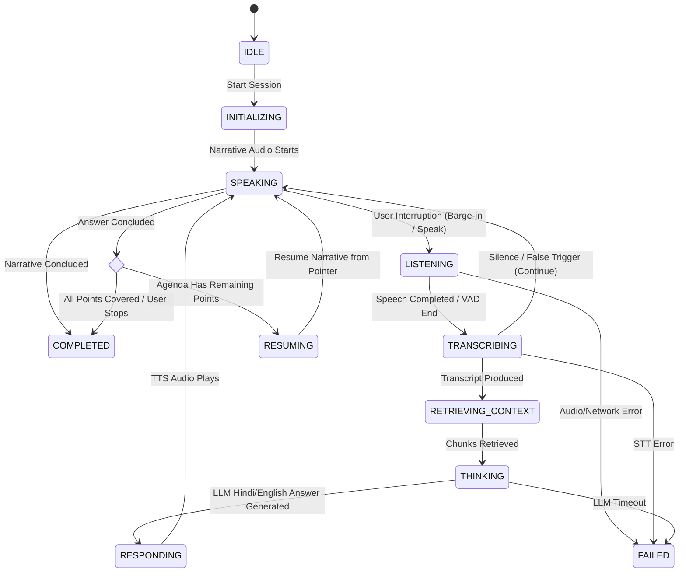

# NotebookLM Interactive Audio Overview: Interaction Analysis & Timbre Architecture

## 1. Executive Summary & Objective

This document analyzes the publicly observable user-interaction patterns of Google NotebookLM's **Interactive Audio Overview** feature and specifies an independent, clean-room implementation for **Timbre**. 

The goal is to translate the core interaction dynamics—ongoing audio narrative, dynamic user interruption ("Join the conversation"), contextual question answering grounded in user-supplied documents, and seamless resumption of the original narrative thread—into Timbre's telephony and local voice agent architecture.

---

## 2. Observable Behavior Analysis

Based exclusively on public documentation, user-facing behavior, and published product demonstrations, the interaction workflow operates through the following mechanisms:

### 2.1 Narrative Presentation
- The system generates and plays a structured conversational overview based on uploaded source documents.
- The dialogue follows a structured outline or agenda (key themes, document highlights, core takeaways).

### 2.2 Joining / Interruption Mechanic
- While audio is playing, the listener can trigger a "Join" action (voice or UI tap).
- The playback stops immediately; no stale audio is played after the interruption.
- The agent transitions to an active listening state, acknowledging that the user has taken the floor.

### 2.3 Spoken Query Capture & Transcription
- The listener speaks a clarification, follow-up, or question in natural colloquial speech.
- The speech-to-text pipeline transcribes the utterance, detecting language and confidence.

### 2.4 Contextual Grounding & Retrieval (RAG)
- The system interprets the user's query in two contexts simultaneously:
  1. **Immediate Context:** What was being spoken right before the interruption.
  2. **Global Document Context:** The ingested notebook sources and reference material.
- The retrieval engine fetches relevant chunks from the source material.

### 2.5 In-Context Answer Generation
- The agent directly answers the listener's question in a concise, conversational tone.
- Answers are strictly grounded in source documents, with explicit citations or attribution.
- If the required information is absent from the sources, the agent politely states that the uploaded material does not contain the answer.

### 2.6 Resumption of Original Discussion
- After answering the listener's question and checking if further clarification is needed, the agent smoothly transitions back to the original narrative thread.
- The system tracks an agenda pointer (`topic_index`, `current_point`, `remaining_points`), ensuring that the discussion resumes where it left off rather than restarting from the beginning.

### 2.7 Handling Edge Cases
- **Unclear / Noisy Speech:** The agent does not hallucinate an interpretation; it politely asks the user to repeat or rephrase.
- **Out-of-Scope Queries:** If the question is outside the source material, the agent acknowledges the question, clarifies that it lies outside the active documents, and asks if the listener wishes to return to the topic.
- **Call/Session Termination:** If the user signals intent to leave or hang up ("stop", "bye", "रुको"), the agent concludes courteously and closes the session.

---

## 3. Confirmed Observations vs. Engineering Hypotheses

| Aspect | Confirmed Public Observation | Timbre Engineering Hypothesis |
| :--- | :--- | :--- |
| **Audio Cancellation** | Audio playback ceases immediately upon user interruption. | Client/telephony provider must discard buffered audio frames upon barge-in signal to prevent playing stale speech. |
| **Grounded Retrieval** | Answers accurately reflect uploaded sources without inventing facts. | Chunk-level vector search combined with BM25 keyword matching (hybrid RAG) provides robust retrieval across Hindi, Hinglish, and English. |
| **Resumption** | The overview continues its original discussion after answering the user. | Requires an explicit Agenda State Machine (`discussion_points`, `current_index`, `resume_prompt`). |
| **Latency** | Noticeable brief turnaround (~1-2s) when answering interrupted questions. | End-to-end latency consists of STT + Vector Retrieval + LLM Generation + TTS Synthesis. |

---

## 4. Timbre Interaction State Machine

---

## 5. Behavioral Requirements for Timbre

1. **State Machine Integrity:** The conversation controller must enforce formal, testable transitions between states (`IDLE`, `INITIALIZING`, `SPEAKING`, `LISTENING`, `TRANSCRIBING`, `THINKING`, `RETRIEVING_CONTEXT`, `RESPONDING`, `RESUMING`, `COMPLETED`, `FAILED`).
2. **Immediate Audio Invalidation:** Whenever state shifts from `SPEAKING` to `LISTENING`, any in-flight TTS generation and client audio buffers must be immediately invalidated.
3. **Agenda Preservation:** An active `AgendaTracker` keeps:
   - `topics`: List of discussion items (e.g., scheme eligibility, required documents, application process, fee exemptions).
   - `current_index`: Active point being presented.
   - `interrupted_at`: Character/time offset when interrupted.
   - `resume_anchor`: Re-entry bridging phrase (e.g., *"जैसा कि हम बात कर रहे थे..."* / *"As we were discussing..."*).
4. **Source Attribution:** Responses indicate the source document and section from which facts were drawn.
5. **Language Flexibility:** Natural Hindi in Devanagari by default; understands Hinglish; respects explicit requests for English.
