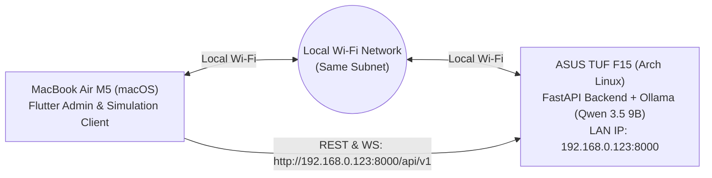

# Timbre MacBook Client Setup & LAN Connectivity Guide

> **Connecting the Flutter Administrative & Simulation Cockpit (macOS) to the ASUS TUF Backend**

This guide provides instructions for developers and evaluators running the Timbre Flutter client on a MacBook Air (Apple Silicon) communicating over the local network with the ASUS TUF development server running Arch Linux.

---

## 1. Network Topology & Overview



- **ASUS TUF Server LAN IP**: `192.168.0.123`
- **Backend API Base URL**: `http://192.168.0.123:8000/api/v1`
- **Interactive Swagger Docs**: `http://192.168.0.123:8000/docs`
- **Health Endpoint**: `http://192.168.0.123:8000/health`

---

## 2. Pre-Flight Connectivity Check from macOS

Both machines must be connected to the same Wi-Fi router/subnet.

From your MacBook terminal, verify network reachability:
```bash
# 1. Ping the ASUS TUF server
ping -c 3 192.168.0.123

# 2. Test HTTP connectivity to the health endpoint
curl -s http://192.168.0.123:8000/health
```

Expected JSON response:
```json
{
  "status": "ok",
  "version": "1.0.0",
  "mode": "demo",
  "database": {"status": "healthy", "details": "SQLite connected"},
  "local_llm": {"status": "healthy", "details": "Target: qwen3.5:9b (Installed: qwen3.5:9b...)"},
  "bolna_voice": {"status": "demo_simulation", "details": "Configured: False, Real Calls Enabled: False"},
  "real_calls_enabled": false
}
```

---

## 3. Flutter Client Configuration

In the Timbre Flutter repository on your MacBook, the backend endpoint is managed in `frontend/lib/core/config/app_config.dart`.

### Option A: Via Runtime UI (Recommended)
1. Launch the Flutter desktop app.
2. In the top navigation bar, click on the **Backend Health Pill** (`Connected` / `Offline`).
3. An **Endpoint Modal** opens allowing you to update the backend host address to `http://192.168.0.123:8000/api/v1` without rebuilding.

### Option B: Static Configuration
Edit `frontend/lib/core/config/app_config.dart`:
```dart
class AppConfig {
  static const String defaultBackendUrl = 'http://192.168.0.123:8000/api/v1';
  static String backendUrl = defaultBackendUrl;
  // ...
}
```

---

## 4. Running the Flutter App

On your MacBook Air:

```bash
cd frontend

# Get Flutter dependencies
flutter pub get

# Run on macOS Desktop
flutter run -d macos

# Alternatively, run on Google Chrome
flutter run -d chrome
```

---

## 5. End-to-End Features Available from macOS

1. **Synthetic Citizens Table**:
   - Paginated display of 100 fictional Indian citizen records.
   - Prominent `is_fictional = true` safeguards and non-dialable placeholder phones (`DEMO-PHONE-xxxx`).
2. **DOB & Life-Event Simulation**:
   - Click *"Simulate 18th Birthday"* for citizen `CIT-0001` (Aarav Sharma).
   - Instant deterministic age recalculation (17 $\rightarrow$ 18) and milestone detection (`MILESTONE_AGE_18`).
3. **Scheme Eligibility Inspector**:
   - Real-time statutory rule evaluation against verified schemes (Voter ID Form 6, Parivahan Learner's Licence, NSP Scholarship, PM-Kisan).
4. **Local AI Conversational Q&A**:
   - Spoken dialogue chat powered by local Qwen 3.5 9B running on the ASUS TUF GPU.
   - Grounded strictly in official government data with verified portal URLs.
5. **Call Queue & Audio Telemetry**:
   - Inspect simulated outbound calls, color-coded Hinglish transcripts, and VAD audio latency metrics.

---

## 6. Troubleshooting

| Symptom | Root Cause | Solution |
| :--- | :--- | :--- |
| `Offline [Retry]` in health pill | ASUS TUF server not running or wrong IP | Run `uvicorn app.main:app --host 0.0.0.0 --port 8000` on ASUS and verify `ip -br addr`. |
| Connection Timed Out | AP isolation or different Wi-Fi networks | Ensure both Mac and ASUS are on the same Wi-Fi band without client isolation enabled. |
| CORS Error on Web | Browser origin not in allowed list | ASUS backend allows `http://localhost:*`, `http://127.0.0.1:*`, and `192.168.0.*`. Check `ALLOWED_ORIGINS` in `.env`. |
